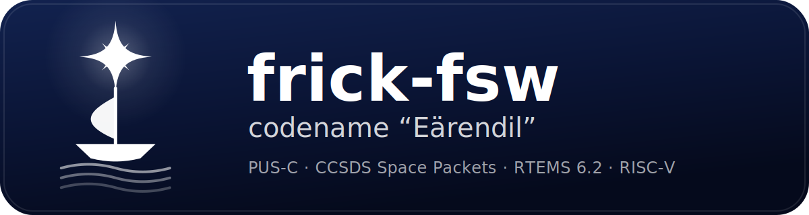
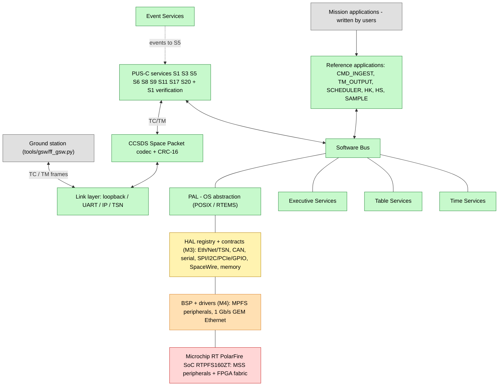
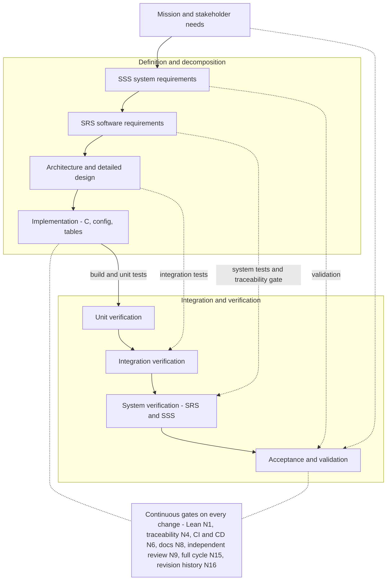

# frick-fsw



**Codename "Eärendil" · v0.1.0 historical release (AGPL-3.0-only) · owner-authorized MPL-2.0 for original project content**

cFS-inspired flight software framework: PUS-C TM/TC over CCSDS Space Packets
for a small/medium spacecraft OBC built on the **Microchip RT PolarFire SoC
RTPFS160ZT** (RISC-V) under **RTEMS 6.2** (open-source RTEMS project), target
ECSS criticality **B**.

**This is a middleware (framework), not a mission application.** It provides the
command & data handling backbone and the interfaces to integrate your own
applications, drivers and third-party stacks; the six `src/apps/*` are reference
applications for demonstration and V&V. See
[`docs/development-plan.md`](docs/development-plan.md) for the product boundary
and the milestone/objective plan.

> Agent-oriented project guide: **`AGENTS.md`**. Non-derogable norms (rules
> N1-N22): **`docs/rules.md`**. Approach & tools: **`docs/tooling.md`**.
> The repository owner authorizes **MPL-2.0 for original project-authored
> content created for frick-fsw** (`LICENSE`, `docs/quality/licensing.md`).
> Third-party/generated component and combined-distribution boundaries remain
> open under NC-EXT-43. The earlier v0.1.0 release used AGPL-3.0-only; prior
> recipients' rights are not changed here.

## Project index (table of contents)

- [Highlights](#highlights)
- [PUS-C services implemented](#pus-c-services-implemented)
- [Low-level drivers](#low-level-drivers)
- [Architecture](#architecture)
- [Development and V&V process (V-model)](#development-and-vv-process-v-model)
- [Quickstart](#quickstart)
- [Documentation index](#documentation-index)
- [Extending the framework](#extending-the-framework)
- [Repository layout](#repository-layout)
- [Contributing](#contributing)
- [Copyright and license](#copyright-and-license)
- [Mirrors](#mirrors)
- [Acknowledgments](#acknowledgments)

<!-- METRICS-BEGIN -->

## Status panel - completion, coverage and review/V&V traffic lights

Maintained by `tools/scripts/metrics.py` (V&V tool T13, norm N8/N10); last updated 2026-10-14. The completion and coverage metrics are generated from `docs/status/status.json`, the traceability manifest, the sprint plan, the review log and the coverage report, and are **refreshed every cycle** (norms N8/N11/N19). Single source of truth: `docs/requirements/traceability.yaml` (mirrored in `traceability.md`).

Legend: **🟢 (GREEN)** recorded gates pass - **🟡 (YELLOW)** at least one gate is open/pending or an issue is deferred - **🔴 (RED)** a recorded gate failed.

### Completion

| Metric | Value | Definition |
| ------ | ----- | ---------- |
| Sprints completed | 9/33 (27.3%) | `docs/status/status.json` + `docs/planning/sprint-plan.md` (FRICK-PLAN-0002) |
| SSS requirements satisfied | 22/30 (73.3%) | all child SRS delivered (else self delivered) |
| SRS requirements delivered | 62/73 (84.9%) | implemented (non-doc) + verified (non-`ci:docs`) |
| Design traceability | 61/73 (83.6%) | SRS IDs found in SDD text (proxy; not semantic matrix validation) |
| Review streams (affirmative latest verdict) | 32/78 (41.0%) | review-log heuristic; latest affirmative, non-scoped conclusion; not NC-closure evidence |

### Coverage

| Metric | Value | Definition |
| ------ | ----- | ---------- |
| Requirements in manifest | 117 (srs=73, sss=30, gap=14) | `traceability.yaml` |
| Requirements with implementation | 117/117 (100%) | manifest implementation list non-empty (incl. `docs/`) |
| Requirements with test/CI evidence | 103/117 (88.0%) | manifest tests list non-empty (incl. planned `ci:docs`) |
| Formal verification coverage (Lean) | 20/117 (17.1%) | manifest Lean link non-empty (norm N1) |
| Code statement (line) coverage | 5651/7933 (71.2%) | gcov |
| Code function coverage | 683/702 (97.3%) | gcov |
| Branch / decision (MC-DC) coverage | not measured | **GAP-A4** (certified checker / WCET) |

### Semaphores

| Gate | State |
| ---- | ----- |
| build and unit tests | 🟡 (YELLOW) |
| static analysis | 🟡 (YELLOW) |
| simulator smoke | 🟡 (YELLOW) |
| lean verification | 🟡 (YELLOW) |
| traceability | 🟡 (YELLOW) |
| ci github | 🟡 (YELLOW) |
| ci gitea | 🟡 (YELLOW) |
| documentation set | 🟡 (YELLOW) |
| documentation review | 🟡 (YELLOW) |
| product assurance review | 🟡 (YELLOW) |
| loop audit | 🟡 (YELLOW) |
| renode functional validation | 🟡 (YELLOW) |
| reviews | 🟡 (YELLOW) |
| vv records | 🟡 (YELLOW) |

**Overall: 🟡 (YELLOW)**

Issues explicitly deferred in the status registry: none. Open/pending gates are listed above; product-scope deferrals are documented separately.

> **Metrics note.** These are project-selected completion/coverage indicators; they are not ECSS thresholds and do not imply an approved mission criticality assignment. Values are computed by `tools/scripts/metrics.py` (T13). *Requirements traceability* is mandated by ECSS-E-ST-40C 5.8.3.x as a **matrix** (Annex R applies it at criticality B; in-source requirement tagging is a permitted means, not a requirement). *Design traceability* follows the SDD DRD (Annex F <6>); the SDD carries the requirements->design matrices (SDD section 6). Project guidance targets **100% statement + branch/decision coverage with justified exceptions**; this target is not a mission-approved criticality assignment. The measured statement coverage (see the Coverage table above) and the absent branch/MC-DC and WCET results are tracked as **GAP-A4**. *Review streams* and *sprint* figures are process indicators, and the completion percentages are **indicators, not claims of ECSS compliance or qualification**.

<!-- METRICS-END -->

> **Status interpretation.** The yellow semaphores above describe open or
> unverified development/CI gates for this repository revision. They do **not** assert
> ECSS compliance, software qualification, independent human V&V, or flight
> readiness; the project remains a middleware prototype and the applicable
> mission tailoring and assurance evidence require authorized program approval.

## Highlights

- **PUS-C** (ECSS-E-ST-70-41C) on CCSDS Space Packets (CCSDS 133.0-B-2) with
  CRC-16/CCITT-FALSE trailer; pluggable backend: the N7 Space / ESA ASN.1/ACN
  PUS-C library (`asn1-pusc-lib`, ASN1SCC-compiled) is the **default**
  (`make pus-asn1`, `FF_USE_PUS_ASN1`), the open CCSDS codec is the fallback, and
  a documented commercial PUSopen adapter is optional (`FRICK_USE_PUSOPEN`).
- **cFS-style core**: PAL, Software Bus, Event Services, Executive Services,
  Table Services, Time Services; six reference applications.
- **Same sources** for the native simulator and the RTEMS 6 target
  (`riscv/mpfs64imafdc`, Microchip RTPFS160ZT).
- **Formal verification with Lean 4** (norm N1): CRC, Software Bus, PUS
  counters, CCSDS length bounds — requirement theorems linked from the
  traceability manifest.
- **Common V&V environment**: controlled Docker image, GitHub Actions + Gitea
  Actions via `act_runner` (norm N6), and traceability gate
  `tools/scripts/trace.py`. The image's mutable base/package inputs do not
  establish reproducibility (NC-EXT-35).
- **Backwards ECSS engineering data**: SSS, SRS, traceability matrices,
  architecture, ADRs, ICD, quality (class B baseline + class A gaps).
- **Security**: CCSDS **SDLS** (355.0-B) with security-association and
  **key management/rotation**, pluggable cryptographic backend (`src/security/`).
- **Mathematics**: portable **libm** facade (`src/math/`) for deterministic,
  licensed use; no `<math.h>` in the deterministic core.
- **Networking**: pluggable TCP/IP (`FF_NetStack_t`; lwIP reference, Tuxera/custom
  by the user) and native **TSN** on the GEM (802.1Q/Qbv + an 802.1AS time-read
  seam), plus a loopback
  backend (`src/drivers/net/`, `src/hal/net/`).
- **Renode + open-source RTEMS 6.2 V&V** (norm N18): functional validation on an
  emulated PolarFire SoC (`make renode-env`, `make renode`).

## Project scope (what is included)

frick-fsw is a **middleware/framework**: the applications under `src/apps/` are
**reference/demo only** — you write your own on the SB/PUS/HAL seams. Consolidated
scope (implemented / interface-only / planned / user-provided):

| Layer / resource | Implemented now (this repo) | Interface-only | Planned | User-provided |
| ---------------- | --------------------------- | -------------- | ------- | ------------- |
| PAL (tasks/mutex/queue/time/console) | POSIX (host + RTEMS) + RTEMS bootstrap | — | — | — |
| Core services | SB, EVS, ES, TBL, Time (+ PPS) | — | — | — |
| PUS-C | services 1/3/5/6/8/9/11/17/20; **default backend N7/ESA ASN.1** | `FF_Pus_Backend_t` | full fundamental set (**M15**); S20/S23 | PUSopen adapter |
| Transport | CCSDS Space Packets; link backends loopback/UART/IP/TSN (+ seg/reassembly) | `FF_Link_t` | — | radio back-ends |
| HAL contracts | registry + `hal_*.h` | ETH, NET, TSN, CAN, SERIAL, SPI, I2C, PCIE, GPIO, SPACEWIRE, MEM, NVM, BLOCK | — | any backend |
| Drivers | GEM Ethernet + native TSN; MSS GPIO; MSS MMUART; RAM pool/DMA; eNVM NVM; QSPI/NOR MTD; MSS CAN; MSS I2C; MSS SPI; MSS MMC/SD (BLOCK); PCIe; SpaceWire (contract-level) | — | — | — |
| Networking | lwIP adapter; loopback stack | `FF_NetStack_t` | — | Tuxera/custom stack |
| Security | CCSDS SDLS + key mgmt/rotation | `FF_CryptoBackend_t` | — | mission crypto/HSM |
| Mathematics | libm facade | — | — | — |
| File transfer | — | — | **CFDP + virtual filestore (VFS) + PUS-C S23** (**M15**) | — |
| Autonomy | — | — | **OBCP engine integration (uPython)** (**M12**) + **in-house OBCP engine** (**M16**); equipment manager + fault mgmt (**M13**) | mission apps |
| Execution cores | single U54 | — | **RTEMS SMP / multicore** (**M14**) | — |
| V&V | host simulator; **Renode (open RTEMS)**; **QEMU generic-BSP run (`make qemu`)**; trace/Lean/format gates | — | certified MISRA checker (**GAP-A4**) | HWIL (**GAP-A5**) |

## PUS-C services implemented

PUS-C (ECSS-E-ST-70-41C) telecommand dispatch and telemetry over the open
CCSDS backend (`src/pus/pus.c`, `src/pus/pus_services.c`):

| Service | Name | Implemented subservices |
| ------- | ---- | ----------------------- |
| 1 | Request verification | 1,2,4,8 acceptance/start/progress/completion (framework-generated) |
| 3 | Housekeeping | 1 create, 2 delete, 3 enable, 4 disable, 27 report (provider-registered) |
| 5 | Event reporting | 1-3 event messages (via EVS listener) |
| 6 | Memory management | 5 dump (region-bounded, registered regions only) |
| 8 | Function management | 1 function invocation (provider-registered) |
| 9 | Time management | 1 set time (CUC), 2 report time (CUC) |
| 11 | Scheduling | 1,2 stub (returns NOT_IMPLEMENTED) |
| 17 | Test | 1 connection test (ping/pong) |
| 20 | Parameter management | 1 set, 3 report (provider-registered) |

Planned extensions (`docs/roadmap.md`, `docs/development-plan.md`): MPFS BSP
layers; the remaining M4 scope — CAN-FD/CANopen/RS-485 DE backends
(SRS-REQ-062/063/064), the generic fabric-device contract (SRS-REQ-067) and the
PUSopen adapter (SRS-REQ-065); PUS-C service 23 file management + CFDP (M15);
and the autonomy/multicore milestones (M12-M14, M16).

## Low-level drivers

The framework hides the hardware behind the PAL, the transport link(s) and the
**HAL contracts** (`src/hal/hal_*.h`). Reference implementations available:

| Driver | File | Notes |
| ------ | ---- | ----- |
| PAL (POSIX) | `src/core/pal/pal_posix.c` | host simulator and RTEMS 6 POSIX surface |
| PAL (RTEMS) | `src/core/pal/pal_rtems.c` | RTEMS bootstrap (POSIX keys, clock, panic) |
| Link loopback | `src/transport/link/link_loopback.c` | in-memory loopback (simulator/tests) |
| Link UART | `src/transport/link/link_uart.c` | serial link (host `/dev/ttyUSB0` or RTEMS console) |
| Link IP (PUS-C) | `src/transport/link/link_ip.c` | IP `FF_Link_t` backend, UDP default + TCP with the seg framing layer, over any `FF_NetStack_t` (S4b; SRS-REQ-060); host test `test_link_ip` |
| Link TSN (PUS-C) | `src/transport/link/link_tsn.c` | TSN-scheduled Ethernet `FF_Link_t` backend (EtherType 0x88F5, callback-driven RX ring) over `FF_EthMac_t + FF_TsnBackend_t` (S4b; SRS-REQ-061); host test `test_link_tsn` |
| Board (MPFS) | `src/bsp/mpfs/board.c` | RTPFS160ZT bring-up placeholder behind `FF_BoardInit` |
| Ethernet (GEM) | `src/drivers/eth/gem/` | Cadence GEM MAC driver behind `FF_EthMac_t` (M4, host-testable; on-target PHY = GAP-A5) |
| TSN (GEM) | `src/drivers/eth/gem/ff_gem_tsn.c` | GEM native TSN backend behind `FF_TsnBackend_t` (802.1Q/Qbv + an 802.1AS time-read seam) |
| Net stack (loopback) | `src/drivers/net/ff_net_loopback.c` | reference `FF_NetStack_t`; third-party stacks (lwIP) plug into the same vtable |
| Serial (MSS MMUART) | `src/drivers/serial/mpfs/ff_serial_mpfs.c` | MSS MMUART (NS16550, 4-byte registers) backend behind `FF_Serial_t`; host test (mock MMIO) + Renode MMIO check (M4/M11) |
| GPIO (MSS) | `src/drivers/gpio/mpfs/ff_gpio_mpfs.c` | MSS GPIO backend behind `FF_Gpio_t`; host test (mock MMIO) + Renode MMIO check (M4/M11) |
| Memory (RAM pool + DMA) | `src/drivers/mem/ff_mem_static.c` | static `FF_MemPool_t` + reference `FF_Dma_t`; host test + Renode DDR check (M4/M11) |
| NVM (MSS eNVM) | `src/drivers/nvm/mpfs/ff_nvm_mpfs.c` | bounded eNVM key/value backend behind `FF_Nvm_t`; host test (mock MMIO) + Renode eNVM data write/read check (M4/M11) |
| NOR flash (MSS QSPI) | `src/drivers/mtd/mpfs/ff_mtd_mpfs.c` | byte-addressed NOR MTD backend behind `FF_Mtd_t` (sector-aligned erase); host test (mock MMIO); Renode check pending the QSPI controller command driver (M4) |
| CAN (MSS) | `src/drivers/can/mpfs/ff_can_mpfs.c` | classic CAN 2.0 A/B backend behind `FF_CanBackend_t` (round-robin TX, accept-all RX + poll); host test (mock MMIO) + Renode MMIO register check (M4/M11) |
| I2C (MSS) | `src/drivers/i2c/mpfs/ff_i2c_mpfs.c` | polled CoreI2C master backend behind `FF_I2c_t` (7-bit addressing, SI-clear sequencing, serial-clock divider); host test (mock MMIO) + Renode MMIO register check (M4/M11) |
| SPI (MSS) | `src/drivers/spi/mpfs/ff_spi_mpfs.c` | polled CoreSPI master backend behind `FF_Spi_t` (8-bit frames, CS control, CLKRATE divider); host test (mock MMIO) + Renode MMIO register check (M4/M11) |
| BLOCK (MSS MMC/SD) | `src/drivers/block/mpfs/ff_block_mpfs.c` | polled SDHCI-style buffer-mode backend behind `FF_BlockDev_t` (CMD17/18 read, CMD24/25 write); host test (mock MMIO) + Renode MMIO register check (M4/M11) |
| PCIe (MSS) | `src/drivers/pcie/mpfs/ff_pcie_mpfs.c` | ECAM configuration-space backend behind `FF_Pcie_t`; host test (mock MMIO) + Renode MMIO check (`hal_pcie=PASS`; full enumeration/BAR/DMA = GAP-A5; M4/M11) |
| SpaceWire (MSS) | `src/drivers/spacewire/mpfs/ff_spacewire_mpfs.c` | `FF_SpaceWire_t`/`FF_Rmap_t` contract-level reference backend; host test (no emulated peripheral: `hal_spacewire=CONTRACT`, NC-S7-01; M4/M11) |
| PPS (1 Hz tone) | `src/core/time/pps.c` | software `FF_PpsSwBackend` behind `FF_PpsBackend_t`; hardware capture on target = **GAP-A7** |

GPIO: `src/drivers/gpio/mpfs/ff_gpio_mpfs.c` implements the `FF_Gpio_t` contract
(bus-injected MMIO, allocation-free, single instance), validated by the host unit
test `test_gpio` (mock MMIO) and by an emulated-MMIO round trip on the Renode
PolarFire SoC board platform (`beaglev-fire`, which includes the SoC; milestone
M11; SRS-REQ-047).

The table above is the delivered reference set. Items still open are tracked, not
deferred silently: the SpaceWire contract-level limit and its absent emulated
peripheral (NC-S7-01), the NET packet round-trip and the full GEM DMA path (GAP-A5;
NC-S6-01), the on-SoC eMMC/SD storage checks, and the on-target PPS
capture (**GAP-A7**). See the detailed
**driver development and integration guide** for humans and agents:
`docs/engineering/driver-development.md`, and the
[`docs/development-plan.md`](docs/development-plan.md) ·
[`docs/quality/class-a-gaps.md`](docs/quality/class-a-gaps.md).

## Architecture



**Legend** — 🟩 implemented in this repository · 🟨 interface/contract delivered
here · 🟧 planned reference implementation (M4) · ⬜ user-provided · 🟥 hardware
/ FPGA IP (not in this repository). The same software runs on the host simulator
and on the MPFS target; see `docs/architecture/hardware-abstraction.md`.

See `docs/architecture/overview.md` for the narrative architecture and
`docs/interfaces/ICD.md` for the packet interfaces.

## Development and V&V process (V-model)



The full plan, including the per-change cycle, is in
`docs/vv/verification-plan.md`.

## Quickstart

```bash
# Containerized configure/build/test/Lean/trace cycle (norm N6; this target does
# not run format, smoke, GSW, RTEMS cross-build, or Doxygen; mutable inputs limit
# reproducibility, NC-EXT-35):
make ci-local
make smoke                    # separate native simulator smoke test
make docs                     # separate Doxygen generation
make format                   # format sources (mutates files; run before review)

# Or natively:
make configure build test      # build + unit tests (ctest)
make run                       # boot the native simulator (6 apps)
make verify-lean               # lake build (formal verification, norm N1)
make trace                     # traceability convergence gate (norm N4)

# PUS-C ASN.1 default backend (N7/ESA); regenerate the generated C (build-time):
make pus-asn1                  # ASN1SCC generation; default ON (FF_USE_PUS_ASN1)

# Renode V&V environment (norm N18):
make renode-env                # self-test: Renode runs + PolarFire SoC board platform loads
make renode-image renode       # build the RTEMS image + emulated functional validation

# QEMU emulated target (milestone M10, generic riscv/rv64imafdc BSP):
make qemu-image qemu           # build the generic image + run it on qemu-system-riscv64 -M virt
make qemu-image-docker         # same build inside the RTEMS toolchain image (no host toolchain)

# RTEMS 6.2 cross build (open-source RTEMS; Docker inputs are mutable, so
# bit-for-bit reproducibility is not established, NC-EXT-40):
make rtems-toolchain           # build the open RTEMS 6.2 toolchain image
make rtems-docker              # cross compile inside the image (no host toolchain)
make rtems
```

## Repository layout

| Path | Content |
| ---- | ------- |
| `src/` | C framework (core, transport, PUS, apps, BSP, HAL, drivers, math, security, main) |
| `config/` | single configuration point + mission tables + platform headers |
| `tests/` | unit tests (ctest) |
| `verification/lean/` | Lean 4 formal verification project |
| `tools/` | scripts, ground station, Docker V&V environment |
| `assets/` | project marks (logo) for codename "Eärendil" |
| `docs/` | rules, requirements, architecture, ADRs, ICD, quality, V&V, reviews |
| `board/` | device-tree template for the RTPFS160ZT |
| `.github/`, `.gitea/` | CI/CD pipelines |

## Documentation index

- **Rules & norms**: [`docs/rules.md`](docs/rules.md) (N1-N22) ·
  [`AGENTS.md`](AGENTS.md)
- **Requirements**: [`docs/requirements/SSS.md`](docs/requirements/SSS.md) ·
  [`SRS.md`](docs/requirements/SRS.md) ·
  [`traceability.yaml`](docs/requirements/traceability.yaml) ·
  [`traceability.md`](docs/requirements/traceability.md)
- **Architecture**: [`docs/architecture/overview.md`](docs/architecture/overview.md) ·
  [`pus-layer.md`](docs/architecture/pus-layer.md) ·
  [`time-and-timecode.md`](docs/architecture/time-and-timecode.md) ·
  [`hardware-abstraction.md`](docs/architecture/hardware-abstraction.md) ·
  [`rtems-integration.md`](docs/architecture/rtems-integration.md) ·
  [`numerics.md`](docs/architecture/numerics.md) ·
  [`security-sdls.md`](docs/architecture/security-sdls.md) ·
  [`network-stack.md`](docs/architecture/network-stack.md) ·
  [`component-gap-analysis.md`](docs/architecture/component-gap-analysis.md) ·
  [`pus-c-from-scratch-assessment.md`](docs/architecture/pus-c-from-scratch-assessment.md) ·
  [`design/software-design.md`](docs/design/software-design.md) ·
  [`docs/adr/`](docs/adr/) · [`docs/interfaces/ICD.md`](docs/interfaces/ICD.md)
- **Quality**: [`docs/quality/ecss-criticality-b.md`](docs/quality/ecss-criticality-b.md) ·
  [`ecss-compliance-matrix.md`](docs/quality/ecss-compliance-matrix.md) ·
  [`class-a-gaps.md`](docs/quality/class-a-gaps.md) ·
  [`configuration-management.md`](docs/quality/configuration-management.md) ·
  [`product-assurance.md`](docs/quality/product-assurance.md) ·
  [`safety-and-fdir.md`](docs/quality/safety-and-fdir.md) ·
  [`misra-c.md`](docs/quality/misra-c.md) ·
  [`licensing.md`](docs/quality/licensing.md)
- **V&V**: [`docs/vv/verification-plan.md`](docs/vv/verification-plan.md) ·
  [`comprehensive-test-spec.md`](docs/vv/comprehensive-test-spec.md) ·
  [`system-verification-architecture.md`](docs/vv/system-verification-architecture.md) ·
  [`validation-plan.md`](docs/vv/validation-plan.md) ·
  [`verification-results.md`](docs/vv/verification-results.md) ·
  [`emulated-target.md`](docs/vv/emulated-target.md) ·
  [`renode-environment.md`](docs/vv/renode-environment.md) ·
  [`tool-qualification.md`](docs/vv/tool-qualification.md)
- **Reviews**: [`docs/engineering/independent-review.md`](docs/engineering/independent-review.md) ·
  [`docs/reviews/`](docs/reviews/)
- **Engineering guides**: [`Design Description and Justification File (DDJF)`](docs/engineering/software-description.md) ·
  [`driver-development.md`](docs/engineering/driver-development.md) ·
  [`service-development.md`](docs/engineering/service-development.md) ·
  [`user-integration-manual.md`](docs/engineering/user-integration-manual.md) ·
  [`coding-style.md`](docs/engineering/coding-style.md)
- **Formal verification**: [`docs/verification/formal-verification.md`](docs/verification/formal-verification.md)
- **Planning**: [`docs/development-plan.md`](docs/development-plan.md) ·
  [`docs/roadmap.md`](docs/roadmap.md) ·
  [`docs/planning/sprint-plan.md`](docs/planning/sprint-plan.md) ·
  [`docs/tooling.md`](docs/tooling.md)
- **Status & reference**: [`docs/status/status.json`](docs/status/status.json) ·
  [`docs/status/handover.md`](docs/status/handover.md) (resume point) ·
  [`docs/status/loop-audit.md`](docs/status/loop-audit.md) (norm N19 audit) ·
  [`docs/glossary.md`](docs/glossary.md) · [`CHANGELOG.md`](CHANGELOG.md)

## Extending the framework

- Add or integrate a **low-level driver** (link, board/PPS, HAL backend):
  [`docs/engineering/driver-development.md`](docs/engineering/driver-development.md).
- Add or extend a **PUS-C service**:
  [`docs/engineering/service-development.md`](docs/engineering/service-development.md).
- Integrate your own **application**: see the
  [`docs/engineering/user-integration-manual.md`](docs/engineering/user-integration-manual.md).
- Planned milestones: [`docs/development-plan.md`](docs/development-plan.md) ·
  [`docs/roadmap.md`](docs/roadmap.md).

## Roadmap & sprint plan

Execution view of the roadmap: **how and in what order** the remaining
milestones are completed. Kept current per norm N8 and re-baselined at every loop
start per norm N19 (see [`docs/planning/sprint-plan.md`](docs/planning/sprint-plan.md);
milestone status in [`docs/roadmap.md`](docs/roadmap.md) and
[`docs/status/status.json`](docs/status/status.json)).

The remaining “drivers first” directive conflicts with the proposed corrective
sequence in the sprint plan; **the human owner has not approved precedence**
(NC-EXT-30). Do not treat either order as authorized until reconciled. ECSS
Category B is the project target, not an assigned or accepted mission
classification; authoritative classification and tailoring remain program
inputs (norm N5). Tooling is open-source/free where practicable.

| Milestone | Status |
| --- | --- |
| M1, M2, M3, M6, M7, M10 | ✅ done |
| M4, M5, M8, M9, M11 | 🟡 in progress |
| M12, M13, M14, M15, M16, M17 | ⬜ planned |

Current focus: **S8-FU** — continue functional development under N21: correct functional issues and implement missing features committed for the current or previous sprints, and record non-functional findings as open NCs for later review/disposition without stopping unrelated work. N22 requires requirement-based and integration tests to compare nominal and applicable out-of-bound cases against expected results; NC-EXT-47 tracks later assessment of existing test-oracle/coverage evidence. The SB/EVS requirement delta defines arrival, dispatch and ground-receipt boundaries, but `Bmax`/`Rmax`/`Dmin`/`Lmax`, link profile and loss-counter semantics remain authority TBDs: NC-EXT-75/76 stay open and FRICK-REVIEW-0266 is not N14/baseline approval. NC-EXT-77 records a corrected trace-count comment. Owner authorization for original project-authored code and materials is recorded; NC-EXT-43 remains for external/generated boundaries and combined-distribution compatibility. NC-S4b-01..09, NC-EXT-01..77 and GAP-R3-1 remain open. Applicable commit/release and safety/security gates remain separate. T21 remains NOT FULLY QUALIFIED; T1/T13/T18 are not fully requalified, and hosted CI/immutable evidence remain open. See `docs/planning/sprint-plan.md` and `docs/vv/verification-results.md`.

## Contributing

See `CONTRIBUTING.md` (rules N7/N11/N15/N16 apply: full cycle, dual push,
history, reviews). Only `aeronautics-space-fsw-engineer` may commit/push after
all gates and the complete sprint scope pass, unless the user explicitly
delegates. Security: `SECURITY.md`. License: owner-authorized MPL-2.0
for original project content; combined-distribution compatibility remains open
under NC-EXT-43.

## Copyright and license

Copyright (C) 2026 **Ilfrick**

- GitHub: <https://github.com/ilfrick/frick-fsw>
- Gitea: <https://www.housefz.com/git/ilfrick/frick-fsw>

The repository owner authorizes **MPL-2.0 for original project-authored content
created for frick-fsw**, reflected in `LICENSE` and SPDX headers. This scope
excludes third-party, generated, mission-supplied, commercial, and other
externally controlled material, which retains its own terms. Compatibility for
combined distributions remains open under NC-EXT-43; this checkout is not
release-approved while its applicable assurance gates remain open.

## Mirrors

- GitHub: https://github.com/ilfrick/frick-fsw
- Gitea (home): https://www.housefz.com/git/ilfrick/frick-fsw

## Acknowledgments

Architectural inspiration from NASA cFS (Draco); RTEMS 6.2 from the open-source
RTEMS project; Lean 4 by the Lean community. The project is independent and contains
no copied cFS/RTEMS code.

**Codename / third-party name disclaimer.** The project name is **frick-fsw**;
"**Eärendil**" is an internal codename taken from J. R. R. Tolkien's legendarium.
A single name is not protected by copyright; the relevant right, if any, is
trademark. This project is **not affiliated with, endorsed by, or associated
with** the Tolkien Estate or Middle-earth Enterprises, includes no Tolkien text,
and does not use the name as a trademark. "TOLKIEN", "THE LORD OF THE RINGS",
"THE HOBBIT", "MIDDLE-EARTH" and many related names are trademarks of their
owners. See `NOTICE` and `docs/quality/licensing.md §6` (incl. contacts for
licensing and the note that this is not legal advice).
