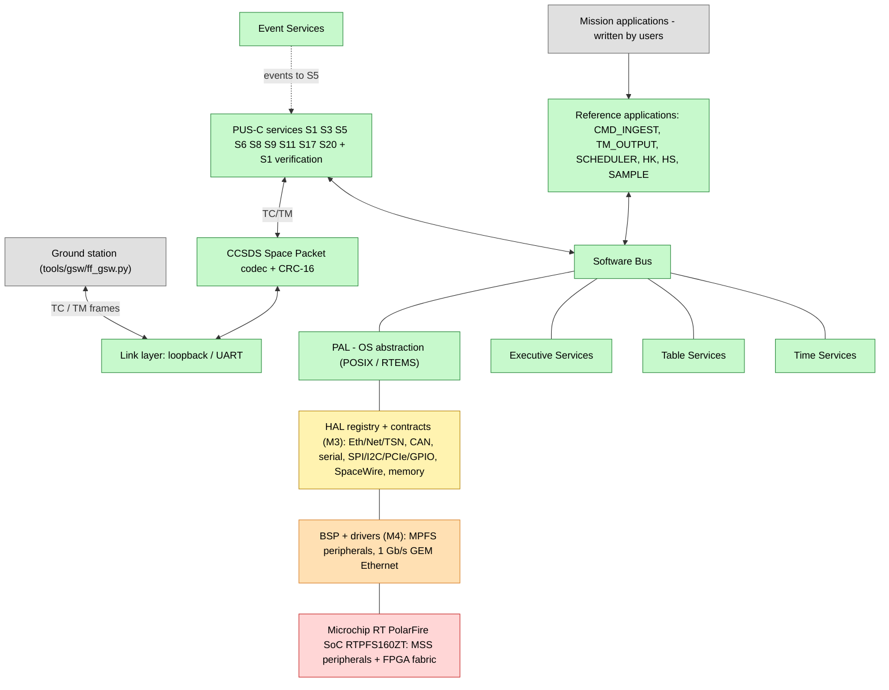
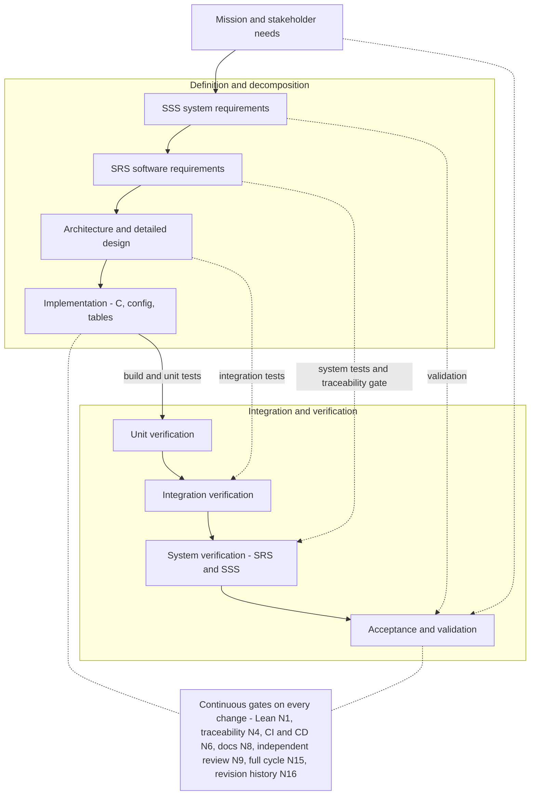

# frick-fsw


**Codename "Eärendil" · v0.1.0 · AGPL-3.0-only**

cFS-inspired flight software framework: PUS-C TM/TC over CCSDS Space Packets
for a small/medium spacecraft OBC built on the **Microchip RT PolarFire SoC
RTPFS160ZT** (RISC-V) under **RTEMS 6.2** (embedded brains ECSS pre-qualified
baseline), target ECSS criticality **B**.

**This is a middleware (framework), not a mission application.** It provides the
command & data handling backbone and the interfaces to integrate your own
applications, drivers and third-party stacks; the six `src/apps/*` are reference
applications for demonstration and V&V. See
[`docs/development-plan.md`](docs/development-plan.md) for the product boundary
and the milestone/objective plan.

> Agent-oriented project guide: **`AGENTS.md`**. Non-derogable norms (rules
> N1-N17): **`docs/rules.md`**. Approach & tools: **`docs/tooling.md`**.
> Licence: **AGPL-3.0-only** (`LICENSE`, `docs/quality/licensing.md`).

## Project index (table of contents)

- [Highlights](#highlights)
- [PUS-C services implemented](#pus-c-services-implemented)
- [Low-level drivers](#low-level-drivers)
- [Architecture](#architecture)
- [Development and V&V process (V-model)](#development-and-vv-process-v-model)
- [Quickstart](#quickstart)
- [Requirements set (current)](#requirements-set-current)
- [Documentation index](#documentation-index)
- [Extending the framework](#extending-the-framework)
- [Repository layout](#repository-layout)
- [Contributing](#contributing)
- [Copyright and license](#copyright-and-license)
- [Mirrors](#mirrors)
- [Acknowledgments](#acknowledgments)

<!-- METRICS-BEGIN -->

## Status panel - coverage and review/V&V traffic lights

Maintained by `tools/scripts/metrics.py` (norm N8/N10); last updated 2026-10-10.

Legend: **🟢 (GREEN)** all pass - **🟡 (YELLOW)** issues deferred by the user - **🔴 (RED)** failures.

### Semaphores

| Gate | State |
| ---- | ----- |
| build and unit tests | 🟢 (GREEN) |
| static analysis | 🟢 (GREEN) |
| simulator smoke | 🟢 (GREEN) |
| lean verification | 🟢 (GREEN) |
| traceability | 🟢 (GREEN) |
| ci github | 🟢 (GREEN) |
| ci gitea | 🟢 (GREEN) |
| documentation set | 🟢 (GREEN) |
| documentation review | 🟢 (GREEN) |
| reviews | 🟢 (GREEN) |
| vv records | 🟢 (GREEN) |

**Overall: 🟢 (GREEN)**

Issues deferred by the user: none.

### Coverage

| Metric | Value |
| ------ | ----- |
| Requirements in manifest | 71 (srs=37, sss=20, gap=14) |
| Requirements with implementation | 71/71 |
| Test coverage (requirements with tests) | 57/71 (80.3%) |
| Formal verification coverage (requirements with Lean) | 20/71 (28.2%) |
| Code line coverage | 1440/2245 (64.1%) - functions 194/237 |

<!-- METRICS-END -->

## Highlights

- **PUS-C** (ECSS-E-ST-70-41C) on CCSDS Space Packets (CCSDS 133.0-B-2) with
  CRC-16/CCITT-FALSE trailer; pluggable backend: open codec (default) and
  documented commercial PUSopen adapter (optional, `FRICK_USE_PUSOPEN`).
- **cFS-style core**: PAL, Software Bus, Event Services, Executive Services,
  Table Services, Time Services; six reference applications.
- **Same sources** for the native simulator and the RTEMS 6 target
  (`riscv/mpfs64imafdc`, Microchip RTPFS160ZT).
- **Formal verification with Lean 4** (norm N1): CRC, Software Bus, PUS
  counters, CCSDS length bounds — requirement theorems linked from the
  traceability manifest.
- **Reproducible V&V**: Docker image, GitHub Actions + Gitea Actions via
  `act_runner` (norm N6), traceability gate `tools/scripts/trace.py`.
- **Backwards ECSS engineering data**: SSS, SRS, traceability matrices,
  architecture, ADRs, ICD, quality (class B baseline + class A gaps).

## PUS-C services implemented

PUS-C (ECSS-E-ST-70-41C) telecommand dispatch and telemetry over the open
CCSDS backend (`src/pus/pus.c`, `src/pus/pus_services.c`):

| Service | Name | Implemented subservices |
| ------- | ---- | ----------------------- |
| 1 | Request verification | 1,2,4,8 acceptance/start/progress/completion (framework-generated) |
| 3 | Housekeeping | 1 create, 2 delete, 3 enable, 4 disable, 27 report (provider-registered) |
| 5 | Event reporting | 1-3 event messages (via EVS listener) |
| 6 | Memory management | 5 dump (region-bounded, registered regions only) |
| 8 | Function management | 1 function invocation (provider-registered) |
| 9 | Time management | 1 set time (CUC), 2 report time (CUC) |
| 11 | Scheduling | 1,2 stub (returns NOT_IMPLEMENTED) |
| 17 | Test | 1 connection test (ping/pong) |
| 20 | Parameter management | 1 set, 3 report (provider-registered) |

Planned extensions (`docs/roadmap.md`): HAL interfaces + integration manuals
(M3, delivered as interfaces); MPFS BSP layers, 1 Gb/s Ethernet driver, PUS
service 23 file management + CFDP, and TCP/IP + TSN transport over PUS-C (M4).

## Low-level drivers

The framework hides the hardware behind three interfaces. Currently available:

| Driver | File | Notes |
| ------ | ---- | ----- |
| PAL (POSIX) | `src/core/pal/pal_posix.c` | host simulator and RTEMS 6 POSIX surface |
| PAL (RTEMS) | `src/core/pal/pal_rtems.c` | RTEMS bootstrap (POSIX keys, clock, panic) |
| Link loopback | `src/transport/link/link_loopback.c` | in-memory loopback (simulator/tests) |
| Link UART | `src/transport/link/link_uart.c` | serial link (host `/dev/ttyUSB0` or RTEMS console) |
| Board (MPFS) | `src/bsp/mpfs/board.c` | RTPFS160ZT bring-up placeholder behind `FF_BoardInit` |
| Ethernet (GEM) | `src/drivers/eth/gem/` | Cadence GEM MAC driver behind `FF_EthMac_t` (M4, host-testable; on-target PHY = GAP-A5) |

Other device drivers (SpaceWire, CAN/CANopen, SPI/I2C, PCIe, GPIO, storage,
PPS) are interface deliverables (M3: HAL contracts) and reference-implementation
deliverables (M4: MPFS BSP + 1 Gb/s Ethernet + stacks). See the detailed
**driver development and integration guide** for humans and agents:
`docs/engineering/driver-development.md` and the
[`docs/development-plan.md`](docs/development-plan.md).

## Architecture



**Legend** — 🟩 implemented in this repository · 🟨 interface/contract delivered
here · 🟧 planned reference implementation (M4) · ⬜ user-provided · 🟥 hardware
/ FPGA IP (not in this repository). The same software runs on the host simulator
and on the MPFS target; see `docs/architecture/hardware-abstraction.md`.

See `docs/architecture/overview.md` for the narrative architecture and
`docs/interfaces/ICD.md` for the packet interfaces.

## Development and V&V process (V-model)



The full plan, including the per-change cycle, is in
`docs/vv/verification-plan.md`.

## Quickstart

```bash
# Full local pipeline inside the reproducible V&V container (norm N6):
make ci-local

# Or natively:
make configure build test      # build + unit tests (ctest)
make run                       # boot the native simulator (6 apps)
make verify-lean               # lake build (formal verification, norm N1)
make trace                     # traceability convergence gate (norm N4)

# RTEMS 6.2 cross build (toolchain: tools/scripts/setup_rtems.sh):
make rtems
```

## Requirements set (current)

SRS = 37 · SSS = 20 · GAP (to class A) = 14 · Lean theorems = 51. The generated
status panel above is authoritative; the single source of truth is
`docs/requirements/traceability.yaml` (mirrored in
`docs/requirements/traceability.md`). See `docs/requirements/`.

## Repository layout

| Path | Content |
| ---- | ------- |
| `src/` | C framework (core, transport, PUS, apps, BSP, HAL, drivers, math, security, main) |
| `config/` | single configuration point + mission tables + platform headers |
| `tests/` | unit tests (ctest) |
| `verification/lean/` | Lean 4 formal verification project |
| `tools/` | scripts, ground station, Docker V&V environment |
| `assets/` | project marks (logo) for codename "Eärendil" |
| `docs/` | rules, requirements, architecture, ADRs, ICD, quality, V&V, reviews |
| `board/` | device-tree template for the RTPFS160ZT |
| `.github/`, `.gitea/` | CI/CD pipelines |

## Documentation index

- **Rules & norms**: [`docs/rules.md`](docs/rules.md) (N1-N17) ·
  [`AGENTS.md`](AGENTS.md)
- **Requirements**: [`docs/requirements/SSS.md`](docs/requirements/SSS.md) ·
  [`SRS.md`](docs/requirements/SRS.md) ·
  [`traceability.yaml`](docs/requirements/traceability.yaml) ·
  [`traceability.md`](docs/requirements/traceability.md)
- **Architecture**: [`docs/architecture/overview.md`](docs/architecture/overview.md) ·
  [`pus-layer.md`](docs/architecture/pus-layer.md) ·
  [`time-and-timecode.md`](docs/architecture/time-and-timecode.md) ·
  [`hardware-abstraction.md`](docs/architecture/hardware-abstraction.md) ·
  [`numerics.md`](docs/architecture/numerics.md) ·
  [`security-sdls.md`](docs/architecture/security-sdls.md) ·
  [`design/software-design.md`](docs/design/software-design.md) ·
  [`docs/adr/`](docs/adr/) · [`docs/interfaces/ICD.md`](docs/interfaces/ICD.md)
- **Quality**: [`docs/quality/ecss-criticality-b.md`](docs/quality/ecss-criticality-b.md) ·
  [`ecss-compliance-matrix.md`](docs/quality/ecss-compliance-matrix.md) ·
  [`class-a-gaps.md`](docs/quality/class-a-gaps.md) ·
  [`configuration-management.md`](docs/quality/configuration-management.md) ·
  [`product-assurance.md`](docs/quality/product-assurance.md) ·
  [`safety-and-fdir.md`](docs/quality/safety-and-fdir.md) ·
  [`licensing.md`](docs/quality/licensing.md)
- **V&V**: [`docs/vv/verification-plan.md`](docs/vv/verification-plan.md) ·
  [`validation-plan.md`](docs/vv/validation-plan.md) ·
  [`verification-results.md`](docs/vv/verification-results.md) ·
  [`tool-qualification.md`](docs/vv/tool-qualification.md)
- **Reviews**: [`docs/engineering/independent-review.md`](docs/engineering/independent-review.md) ·
  [`docs/reviews/`](docs/reviews/)
- **Engineering guides**: [`driver-development.md`](docs/engineering/driver-development.md) ·
  [`service-development.md`](docs/engineering/service-development.md) ·
  [`user-integration-manual.md`](docs/engineering/user-integration-manual.md)
- **Formal verification**: [`docs/verification/formal-verification.md`](docs/verification/formal-verification.md)
- **Planning**: [`docs/development-plan.md`](docs/development-plan.md) ·
  [`docs/roadmap.md`](docs/roadmap.md) · [`docs/tooling.md`](docs/tooling.md)
- **Status & reference**: [`docs/status/status.json`](docs/status/status.json) ·
  [`docs/glossary.md`](docs/glossary.md) · [`CHANGELOG.md`](CHANGELOG.md)

## Extending the framework

- Add or integrate a **low-level driver** (link, board/PPS, HAL backend):
  [`docs/engineering/driver-development.md`](docs/engineering/driver-development.md).
- Add or extend a **PUS-C service**:
  [`docs/engineering/service-development.md`](docs/engineering/service-development.md).
- Integrate your own **application**: see the
  [`docs/engineering/user-integration-manual.md`](docs/engineering/user-integration-manual.md).
- Planned milestones: [`docs/development-plan.md`](docs/development-plan.md) ·
  [`docs/roadmap.md`](docs/roadmap.md).

## Contributing

See `CONTRIBUTING.md` (rules N7/N11/N15/N16 apply: full cycle, dual push,
history, reviews). Security: `SECURITY.md`. License: AGPL-3.0-only.

## Copyright and license

Copyright (C) 2026 **Ilfrick**

- GitHub: <https://github.com/ilfrick/frick-fsw>
- Gitea: <https://www.housefz.com/git/ilfrick/frick-fsw>

frick-fsw is free software, released under the **GNU Affero General Public
License, version 3** (`AGPL-3.0-only`, `LICENSE`). Every authored source,
configuration and build file carries the copyright header and
`SPDX-License-Identifier: AGPL-3.0-only`; engineering documentation is covered
by `LICENSE`/`NOTICE`; third-party components retain their own licences
(analysis in `docs/quality/licensing.md`, `NOTICE`).

## Mirrors

- GitHub: https://github.com/ilfrick/frick-fsw
- Gitea (home): https://www.housefz.com/git/ilfrick/frick-fsw

## Acknowledgments

Architectural inspiration from NASA cFS (Draco); RTEMS 6.2 baseline by embedded
brains; Lean 4 by the Lean community. The project is independent and contains
no copied cFS/RTEMS code.