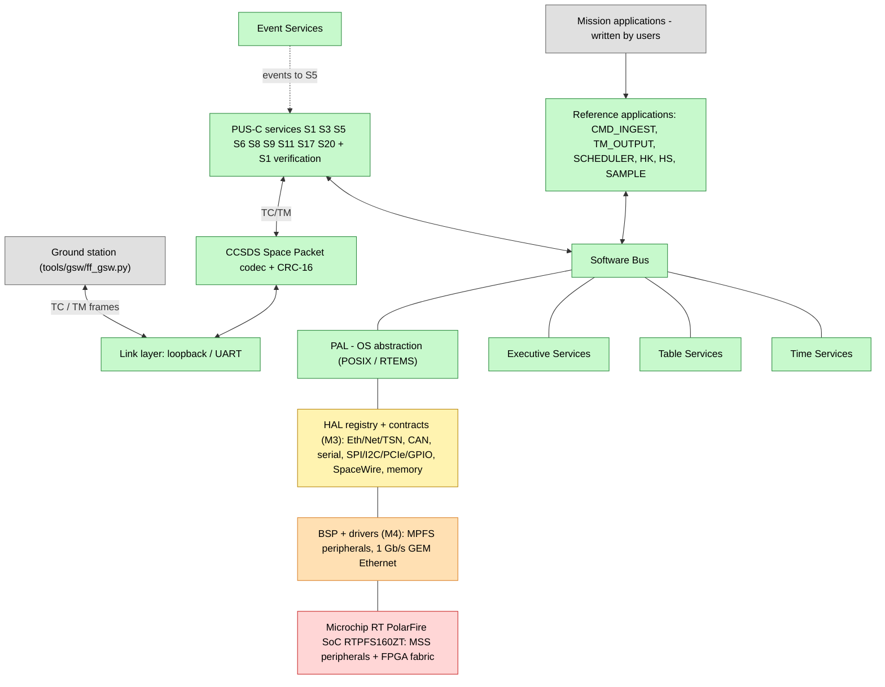

# Architecture Overview

| Document id | FRICK-ARCH-0001 |
| ----------- | --------------- |
| Revision    | 0.1.2 |
| Date        | 2026-10-10 |

## 1. System context

frick-fsw executes on the Microchip **RT PolarFire SoC RTPFS160ZT** (FCVG784)
under **RTEMS 6.2** (open-source RTEMS project, BSP
`riscv/mpfs64imafdc`) and, for development/V&V, as a native POSIX-thread
simulator. It is the command & data handling backbone of a small/medium
spacecraft: it accepts PUS-C telecommands and produces PUS-C telemetry over
CCSDS Space Packets, manages housekeeping, events, time, health & safety and
configuration tables.

```
 ground station <--UART/loopback--> frick-fsw
                                        |
     +----------------------------------+----------------------------------+
     | frick-fsw framework                                                     |
     |  +--------+  +----+  +----+  +----+  +-----+  +------+                |
     |  | PAL    |  | SB |  | EVS|  | ES |  | TBL |  | TIME |   core         |
     |  +--------+  +----+  +----+  +----+  +-----+  +------+                |
     |  +--------------+  +-------------------+  +------------------+        |
     |  | PUS layer (S1,S3,S5,S6,S8,S9,S11,S17,S20)|  | CCSDS codec+CRC  |        |
     |  +--------------+  +-------------------+  +------------------+        |
     |  +------------------+  +------------------+                            |
     |  | link (loopback/uart)| | apps (6 tasks)  |                         |
     |  +------------------+  +------------------+                            |
     +------------------------------------------------------------------------+
     Host simulator: POSIX threads + loopback     Target: RTEMS 6 RISC-V + UART
```

## 2. Component architecture (Mermaid)

The layered view below is the machine-checkable companion of the ASCII sketch
in section 1; it renders on GitHub and Gitea.



**Legend** — green: implemented in this repository; yellow: interface/contract
delivered here; orange: planned reference implementation (M4); grey:
user-provided; red: hardware / FPGA IP (not in this repository). The identical
software runs on the host simulator and on the MPFS target (see
`docs/architecture/hardware-abstraction.md`).

## 3. Component overview

| Component | Responsibility | Key files |
| --------- | -------------- | --------- |
| PAL (portable abstraction layer) | threads, time, queues, logs, consoles for POSIX and RTEMS | `src/core/pal/` |
| Software Bus (SB) | publish/subscribe with fixed-size pipes and wildcard subscriptions | `src/core/sb/` |
| Event Services (EVS) | event log and event listeners (PUS S5 forwarding) | `src/core/evs/` |
| Executive Services (ES) | application registry, lifecycle, reset counters | `src/core/es/` |
| Table Services (TBL) | load / validate / activate of mission tables | `src/core/tbl/` |
| Time Services (TIME) | UTC correlation, CUC encoding | `src/core/time/` |
| CCSDS transport | Space Packet encode/decode, CRC-16/CCITT-FALSE | `src/transport/ccsds/` |
| Link layer | byte-stream transport (loopback / UART) | `src/transport/link/` |
| PUS layer | TC dispatch, S1 verification, TM emission, N7/ESA ASN.1 backend vtable (default) | `src/pus/` |
| Applications | scheduler, command ingest, TM output, HK, HS, sample telemetry | `src/apps/` |
| Hardware abstraction (HAL) | bus/device/memory contracts + bounded registry (M3) | `src/hal/` |
| Board support | RTPFS160ZT init, boot core selection | `src/bsp/mpfs/` |

## 4. Boot sequence

1. PAL init -> SB init -> EVS init -> ES init -> TBL init -> TIME init ->
   board init -> mission tables init (fsw_main.c).
2. PUS init with the N7/ESA ASN.1 backend (default); link init (loopback/UART).
3. EVS listener forwards every event to PUS service 5 telemetry.
4. Six applications are registered with ES and started as tasks.

## 5. Threading and determinism

- Each application runs as an independent task with a fixed stack and a
  subscription pipe of fixed depth; all memory is static (no heap after init,
  SRS-REQ-015/SSS-REQ-010).
- Inter-app communication only via the Software Bus and events; no shared
  mutable state outside explicit services.

## 6. Related documents

- `software-bus.md`, `pus-layer.md`, `platform.md`, `applications.md`,
  `mapping-cfs.md`, `docs/interfaces/ICD.md`, `docs/adr/`.

## 7. History

| Rev   | Date       | Author    | Reason |
| ----- | ---------- | --------- | ------ |
| 0.1   | 2026-10-10 | frick-fsw | Initial architecture overview |
| 0.1.1 | 2026-10-10 | frick-fsw | Added the Mermaid component architecture diagram (norm N8) |
| 0.1.2 | 2026-10-10 | frick-fsw | M3: layer-focused diagram on the MPFS (implemented vs interface vs user vs HW) and HAL component row |