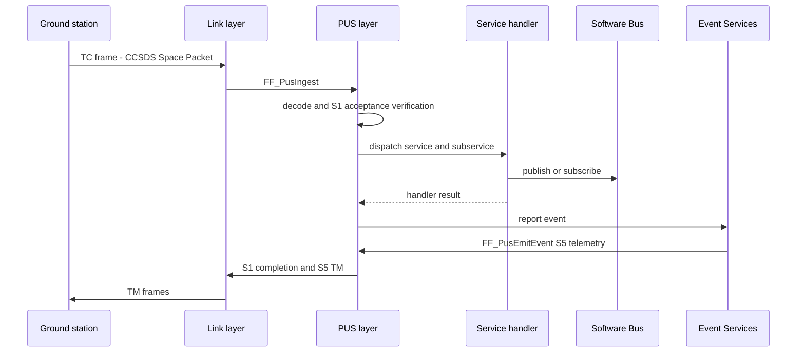

# PUS Layer Architecture

| Document id | FRICK-ARCH-0003 |
| ----------- | --------------- |
| Revision    | 0.1.1 |
| Date        | 2026-10-10 |

## 1. Purpose

The PUS layer implements ECSS-E-ST-70-41C (PUS-C) packet utilisation on CCSDS
Space Packets: TC acceptance and dispatch, S1 verification, TM emission and
the implemented services.

## 2. Backend abstraction (ADR-0003)

```c
typedef struct FF_Pus_Backend {
    FF_Status_t (*decode_tc)(const uint8_t*, uint16_t, uint16_t*, FF_Pus_TcHdr_t*,
                             const uint8_t**, uint16_t*);
    FF_Status_t (*encode_tm)(uint8_t*, uint16_t, uint16_t*, FF_Pus_TmHdr_t*,
                             const uint8_t*, uint16_t);
} FF_Pus_Backend_t;
```

- Default open backend (`FF_PusBackendOpen`): local CCSDS codec
  (`src/pus/adapters/pus_adapter_open.c`, `src/transport/ccsds/ccsds.c`).
- Optional PUSopen backend (`FF_PusBackendPusopen`) behind `FRICK_USE_PUSOPEN`
  (commercial library, never distributed).

## 3. TC flow (FF_PusIngest)

1. decode frame/TC header (backend) -> parse failure yields an EVS error;
2. acceptance verification (S1,1) when `ACK_ACCEPTANCE`;
3. service dispatch table lookup (`service, subservice`);
   unknown -> completion failure (S1,8) with
   `FF_PUS_FAIL_UNKNOWN_SERVICE/SUBSERVICE`;
4. start/progress verifications when requested;
5. handler execution; completion verification (S1,7 success / S1,8 failure).

## 4. TM flow

`FF_PusSendTm` builds a PUS-C TM frame through the backend (Space Packet +
PUS secondary header + CRC) and forwards it to the registered TM sink
(`FF_PusSetTmSink`) which the link layer consumes.

## 5. TC/TM sequence (Mermaid)



## 6. Implemented services (open backend)

| Service | Content |
| ------- | ------- |
| 1  | Verification (acceptance / start / progress / completion) |
| 3  | Housekeeping: create/delete/enable/disable/report |
| 5  | Event reporting (via EVS listener -> `FF_PusEmitEvent`) |
| 6  | Memory management: region-bounded dump |
| 8  | Function management |
| 9  | Time: UTC correlation set, CUC time report |
| 17 | Test: connection test (ping/pong) |
| 20 | Parameter: report (table-backed) |

## 7. Formal model

`Frick.Pus` (Lean) proves the verification-count and counter-monotonicity
contracts of dispatch; `Frick.Ccsds` mirrors the codec
(SRS-REQ-006/007/003/004).

## 8. Traceability

SSS-REQ-003/004/005/006/007/014/015 and the SRS-REQ-00x links in
`docs/requirements/traceability.yaml`.

## 9. History

| Rev   | Date       | Author    | Reason |
| ----- | ---------- | --------- | ------ |
| 0.1   | 2026-10-10 | frick-fsw | Initial PUS layer architecture |
| 0.1.1 | 2026-10-10 | frick-fsw | Added the Mermaid TC/TM sequence diagram (norm N8) |