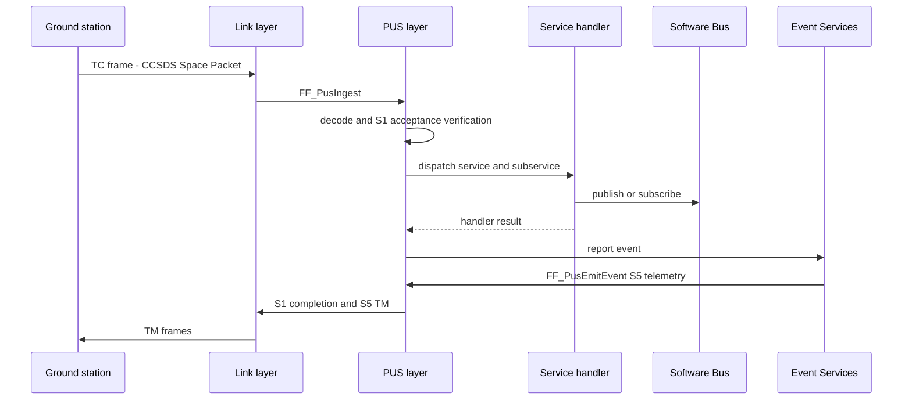

# PUS Layer Architecture

| Document id | FRICK-ARCH-0003 |
| ----------- | --------------- |
| Revision    | 0.1.8 |
| Date        | 2026-10-18 |

## 1. Purpose

The PUS layer implements a bounded framework subset of TC acceptance/dispatch,
S1 verification, TM emission and selected services using ECSS-E-ST-70-41C as a
public design reference. This wording does not claim PUS-C compliance or
mission-profile interoperability; mission tailoring remains open.

## 2. Backend abstraction (ADR-0003)

```c
typedef struct {
    const char *name;
    FF_Status_t (*init)(void);
    FF_Status_t (*encode_tm)(const FF_Pus_TmHdr_t *hdr, const uint8_t *data,
                             uint16_t data_len, uint8_t *out, size_t out_cap,
                             uint16_t *out_len);
    FF_Status_t (*decode_tc)(const uint8_t *raw, uint16_t len, uint16_t *apid,
                             FF_Pus_TcHdr_t *hdr, const uint8_t **data,
                             uint16_t *data_len);
} FF_Pus_Backend_t;
```

This declaration mirrors the compiled public API in `src/pus/pus.h`; that
header is authoritative if this illustrative signature and the implementation
ever diverge. The encoder receives the PUS header and payload first, then the
output buffer/capacity and returned output length.

- **Default backend** (`FF_PusBackendN7`): the N7 Space / ESA `asn1-pusc-lib`
  ASN.1/ACN PUS-C model, ASN1SCC-compiled at build time
  (`src/pus/adapters/pus_adapter_n7.c`, `tools/scripts/gen_pus_asn1.sh`),
  enabled by `FF_USE_PUS_ASN1` (default ON; see `ADR-0019`; generation details
  and no-vendoring decision are in `ADR-0016`). Current integration uses the
  generated common type widths and N7/ESA CRC; it does not yet map service
  payload fields through generated codecs. When `FF_FRAME_WITH_CRC=1`, TC
  decode checks exact PDL/supplied-frame agreement and the minimum secondary
  header plus CRC size, invokes the N7/ESA CRC routine, then delegates field
  decoding to the CCSDS codec. A CRC mismatch returns `FF_CRC_ERROR` before
  decoded TC data is exposed. The adapter seam's controlled-double host test
  uses the pinned generated files and library wrapper; no external/mission N7
  profile compatibility is established.
- Open reference backend (`FF_PusBackendOpen`): local CCSDS codec
  (`src/pus/adapters/pus_adapter_open.c`, `src/transport/ccsds/ccsds.c`) — the
  selectable alternative (`FF_USE_PUS_ASN1=OFF`).
- Optional PUSopen backend (`FF_PusBackendPusopen`) behind `FRICK_USE_PUSOPEN`
  (commercial library, never distributed). The adapter validates the received
  Space Packet type and requires `FF_APID_TC` before invoking the upstream
  decoder; it returns the APID extracted from the received primary header rather
  than substituting the configured value. The controlled API-double test covers
  nominal and invalid-APID paths. The modeled upstream packet has no APID field,
  so no SDK-decoded APID comparison is possible; commercial SDK compatibility
  remains unverified.

## 3. TC flow (FF_PusIngest)

1. decode frame/TC header (backend) -> parse failure yields an EVS error;
2. acceptance verification (S1,1) when `ACK_ACCEPTANCE`;
3. service dispatch table lookup (`service, subservice`);
   unknown -> completion failure (S1,8) with
   `FF_PUS_FAIL_UNKNOWN_SERVICE/SUBSERVICE`;
4. start/progress verifications when requested;
5. handler execution; completion verification (S1,7 success / S1,8 failure).

## 4. TM flow

`FF_PusSendTm` builds a PUS-C TM frame through the backend (Space Packet +
PUS secondary header + CRC) and forwards it to the registered TM sink
(`FF_PusSetTmSink`) which the link layer consumes.

## 5. TC/TM sequence (Mermaid)



## 6. Implemented services (open backend)

| Service | Content |
| ------- | ------- |
| 1  | Verification (acceptance / start / progress / completion) |
| 3  | Housekeeping: TC[3,1] create; TC[3,3] delete; TC[3,5] enable; TC[3,6] disable; TC[3,27] report |
| 5  | Event reporting (via EVS listener -> `FF_PusEmitEvent`) |
| 6  | Memory management: region-bounded dump; provisional payload region ID + byte offset + length (ADR-0020) |
| 8  | Function management |
| 9  | Time: UTC correlation set, CUC time report |
| 11 | Scheduling: registered stub; invocation returns `FF_NOT_IMPLEMENTED` and emits an EVS warning (`FF_EVS_PUS_TC_ERR`) |
| 17 | Test: connection test (ping/pong) |
| 20 | Parameter: set (TC[20,1], report id + value via a registered setter) and report (TC[20,3] -> TM[20,4], provider/table-backed) |

The Service 3 subservice assignments and Service 6 region-ID/offset layout are
provisional public-reference defaults recorded in ADR-0020. TC[3,27] uses the
provisional payload `N:u8` followed by exactly N report IDs; a one-shot report
request is honored even if periodic generation is disabled. ECSS-E-ST-70-41C
requires mission tailoring and an approved Space-to-Ground ICD; this framework
document is not that ICD and does not establish mission profile compatibility or
PUS compliance. Service 6 uses a configured logical region identifier and a
32-bit byte offset into that region, never a serialized host pointer.

## 7. Registration and provider bounds

Service registrations are unique by `(service, subservice)`. A duplicate
registration is rejected with `FF_ALREADY_EXISTS`; it does not replace the
existing handler. HK/parameter providers, parameter setters, and function
handlers are likewise unique by their registry id within their respective
registries. These are local API contracts, not claims about ECSS PUS-C wire
semantics.

HK and parameter providers receive an output capacity in `*len` and return the
number of bytes produced in that field. The caller rejects a returned length
above the supplied capacity with `FF_BAD_SIZE` and emits no report TM for that
provider result. Providers remain responsible for respecting the supplied
capacity while writing; post-call length validation cannot contain a provider
that writes out of bounds. An HK report request propagates a provider failure
instead of reporting successful completion when the provider fails or TM
encoding fails; the first encountered failure is retained while the bounded
loop continues. The TM sink API returns `void`, so downstream transmission or
ground receipt failure cannot be propagated by this service handler.

## 8. Formal model

`Frick.Pus` (Lean) proves the verification-count and counter-monotonicity
contracts of dispatch; `Frick.Ccsds` mirrors the codec
(SRS-REQ-006/007/003/004).

## 9. Traceability

SSS-REQ-003/004/005/006/007/014/015 and the SRS-REQ-00x links in
`docs/requirements/traceability.yaml`.

## 10. History

| Rev   | Date       | Author    | Reason |
| ----- | ---------- | --------- | ------ |
| 0.1   | 2026-10-10 | frick-fsw | Initial PUS layer architecture |
| 0.1.1 | 2026-10-10 | frick-fsw | Added the Mermaid TC/TM sequence diagram (norm N8) |
| 0.1.2 | 2026-10-13 | frick-fsw | Align documented backend vtable with `src/pus/pus.h`; NC-EXT-27 correction pending independent review |
| 0.1.3 | 2026-10-16 | frick-fsw | Document S11 stub visibility, duplicate-registration refusal and provider output-capacity contract for S8-PUS-FU; no PUS-C compliance claim |
| 0.1.4 | 2026-10-16 | frick-fsw | Document N7 adapter TC CRC and structural-boundary checks and their controlled-test evidence limits; NC-EXT-20 remains open pending independent review |
| 0.1.5 | 2026-10-16 | frick-fsw | Clarify PUSopen received-APID validation and controlled-stub limits for NC-EXT-21; vendor SDK compatibility remains open |
| 0.1.6 | 2026-10-16 | frick-fsw | Document S3 report-provider failure propagation (SRS-REQ-008 / NC-EXT-17); profile mapping and independent review remain open |
| 0.1.7 | 2026-10-16 | frick-fsw | Record provisional ECSS-referenced S3 subservices and S6 logical region/offset profile per ADR-0020; mission profile and authority gaps remain open |
| 0.1.8 | 2026-10-18 | frick-fsw | Correct the §6 Service 20 row to list both the registered set (TC[20,1]) and report (TC[20,3] -> TM[20,4]) subservices; no PUS-C compliance claim |
