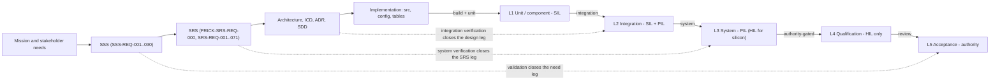

# Test Levels and V-Model Architecture (N22 work package SVA-1)

|                                   |                                        |
| --------------------------------: | :------------------------------------- |
| Project                          | frick-fsw                              |
| Document id                      | FRICK-VV-SVA-WP1                       |
| Revision                         | 0.3                                    |
| Date                             | 2026-10-14                             |
| Norms                            | N5, N10, N11, N15, N21, N22            |
| Umbrella                         | `docs/vv/comprehensive-test-spec.md` (FRICK-VV-TSPEC-001) |
| Work-package index               | `docs/vv/test-spec/README.md` (FRICK-VV-TSPEC-002), work package SVA-1 |
| Companion                        | `docs/vv/system-verification-architecture.md` (FRICK-VV-SVA-001) §1 |
| Plans                            | `docs/vv/verification-plan.md` (FRICK-VV-PLAN-001), `docs/vv/validation-plan.md` (FRICK-VV-VAL-001) |
| Baseline                         | Working tree at HEAD `57974d2` as read 2026-10-14 (uncommitted changes possible) |

> **Authority statement.** This work package defines the system-level verification
> *levels*, the *V-model closure relations*, the *environment fidelity limits*,
> the *environment-selection rules* and the *level acceptance criteria* for the
> current baseline. It does not assign mission criticality, development assurance
> levels, environmental levels, radiation requirements, qualification levels,
> fail-operational status, residual risk or release/flight readiness — those are
> authority-owned (see §8) and are recorded as open items where no authority
> disposition exists. Nothing in this document may be cited as a compliance,
> qualification or airworthiness/mission-acceptance claim.

## 1. Scope, purpose and terminology

This document is the system-architecture half of the N22 test design: the
companion work packages (`ts-1-*` … `ts-6-*`) supply the **cases and oracles**;
this work package places those cases on the verification levels, states which
environment can legitimately establish each case, and defines what "pass" means
at each level.

Three orthogonal concepts are kept separate (`docs/rules.md` N22):

| Concept | Meaning | Defined in |
| --- | --- | --- |
| **Level** (L1…L5) | where on the V the item under test sits (unit, integration, system, qualification, acceptance) | §2, §3 |
| **Category** (TC-REQ, TC-INT, TC-IO, TC-MEM, TC-NUM, TC-CONC, TC-FAULT, TC-RES, TC-SEC) | what kind of behaviour the case probes | §5 |
| **Environment** (SIL, PIL-Renode, PIL-QEMU, HIL) | the physical/emulated platform the case executes on | §4 |

A case is admissible only if the environment named for it can observe the
behaviour the oracle asserts. Requirement-based and integration tests (N22) are
placed by the rules in §5 and flow into the N22 case tables as described in §6.

**Authority-owned inputs referenced but not assigned here**: mission
criticality / ECSS class (project states a *class-B target*; no controlled
mission authority has assigned it — NC-EXT-11), assurance-level mapping,
environmental and qualification levels, radiation requirements, the failure
hypothesis and fault-tolerance objectives (NC-EXT-31), and all release or
flight-readiness decisions.

## 2. Verification levels

`Tst` = Test, `Anl` = Analysis, `Inp` = Inspection, `Dem` = Demonstration,
`MIR` = mission/qualification-readiness review (method vocabulary per
`docs/quality/ecss-criticality-b.md`; ECSS editions as recorded in the
companion FRICK-VV-SVA-001 — not independently re-verified in this work package).

| Level | Scope | ECSS method(s) | Environment | Entry criteria | Exit criteria | What it can and cannot establish |
| --- | --- | --- | --- | --- | --- | --- |
| **L1 Unit / component** | one module or one function against its declared contract: SB, EVS, ES, TBL, time/CUC, CCSDS codec, PUS core and implemented services, math facade, HAL registry, driver logic over an injected/mock MMIO bus | `Tst`, `Anl` (Lean N1, bounds/arithmetic analysis), `Inp` (static analysis, no-heap-after-init, stack/aliasing inspection) | **SIL** (native host `ctest`, ASan/UBSan legs, mock MMIO); Lean models for the modeled subset | host build green; every case grounded in a controlled SRS clause or a header/ICD clause; suite registered under a qualified tool (T2/T3/T5/T8/T12, N10); declared preconditions of the case do not assume another level's evidence | all unit suites pass; sanitizer legs clean; `lake build` green and every requirement–theorem link resolves; `make trace` exits 0 (N4); coverage recorded | **Establishes**: host-ABI functional logic; protocol byte layouts and encode/decode; bounded arithmetic; API contract behaviour for nominal and out-of-bound inputs with a controlled oracle; host memory safety. **Cannot establish**: target ABI/alignment, real MMIO/interrupt/DMA/cache behaviour, RTEMS scheduling and timing, on-target stack/WCET, electrical/thermal/radiation behaviour, or anything the module delegates to the platform |
| **L2 Integration** | two or more integrated components, or a component with its platform/interface: SB↔apps, PUS↔CCSDS↔link, EVS→PUS S5, TBL↔NVM/MTD, HAL contract↔driver↔emulated peripheral, PAL↔RTEMS BSP, GEM↔netif/lwIP, link↔GSW | `Tst`, `Dem`, `Inp` | **SIL** primary; **PIL-Renode** for platform/peripheral seams; **PIL-QEMU** for BSP-independent bring-up | L1 exit green for the components involved; the ICD/HAL clause that grounds each oracle is identified (`docs/interfaces/ICD.md`, `src/hal/hal_*.h`); the emulated image is built from the same sources and the tool status is known (T17/T20); a **per-check observable** is defined per case, never an aggregate marker | every declared integration case has a recorded per-case observable and result; uncovered interface pairs are recorded against NC-EXT-47; emulator results carry the model limitation that bounds them | **Establishes**: interface ordering/lifecycle coupling; cross-module error propagation; RTEMS boot/PAL/tasking bring-up (QEMU); seam binding and register-level MMIO round trips on emulated peripherals (Renode). **Cannot establish**: behaviour the model omits (GEM DMA descriptor engine, QSPI command path, SD card, PCIe root complex, TSN screener programming), real timing/jitter/IRQ latency, electrical/thermal/radiation behaviour, silicon errata |
| **L3 System** | the framework as one system in its configured form: boot, application registration/lifecycle (6 apps), end-to-end TM/TC through the configured link and GSW, time base integration, observable HS/FDIR behaviour, restart/boot-repeat | `Dem`, `Tst`, `Inp` (configuration inspection, deterministic-memory inspection) | **PIL** (Renode MPFS image; QEMU generic-BSP variant separately); **SIL** smoke for the host configuration; target only via L4 | L2 exit green; system-level criteria and step procedures written with explicit oracles; the configuration is identified (commit, `config/fsw_config.h`, mission tables, image, toolchain); L1/L2 evidence is current for that configuration | system criteria pass in the named environment with retained logs; every unestablished system-level claim is recorded against GAP-A4/A5/A6 and NC-EXT-47; no system claim rests on `RENODE_TEST: PASS` or any aggregate marker | **Establishes**: end-to-end framework behaviour under the configured environment; boot/app/TM-TC/time-path integration; ground-station decode of emitted TM; run-to-run repeatability *in the emulator*. **Cannot establish**: mission profile and operations, external ground-segment interoperability (NC-EXT-03), target timing/electrical/thermal/radiation behaviour, hardware watchdog escalation, mission-level availability |
| **L4 Qualification** | the item against its installation, environment and workload: WCET / IRQ latency / jitter, power-on/brownout/clock-fail/watchdog, DMA and cache coherency, thermal/vibration/EMC, radiation (SEE/SEL/SEFI), endurance and NVM wear, multicore interference | `Tst`, `Anl`, `Inp` (+`Dem` where the approved campaign allows) | **HIL**: target RTPFS160ZT under RTEMS 6.2 with harness and approved facilities | L3 exit green; **authority-approved** environmental/qualification levels, failure hypothesis and fault-tolerance objectives available; representative harness and configuration; calibrated instrumentation; approved test-safety plan | qualification reports reviewed; anomalies dispositioned; deviations approved; residual risk accepted by the authority | **Establishes** (only when executed on real hardware under an approved campaign): silicon/board behaviour, timing bounds under real workload, environmental and radiation behaviour. **Cannot establish here**: this level is **not runnable in this repository** — no flight hardware and no authority-assigned levels exist, so every L4-dependent claim is open (GAP-A4/A5/A6/A7/A14, NC-EXT-31). Emulator or host results may not be substituted, and L4 alone does not establish mission availability |
| **L5 Acceptance** | release / flight-readiness review of the as-configured product against the SSS and the mission need: evidence envelope, NC status, tool qualification, configuration identity, limitations | `MIR`, `Inp`, `Dem` | **As-configured**: the recorded SIL/PIL/target configurations plus the documentation set | L1–L3 exit green; L4 status **explicit** (executed, or formally deferred and accepted by the authority — never by this document); NC register dispositioned; N9/R2, N17/R4 and N20/PA reviews closed for the increment; evidence retained under N11 with a configuration identity (NC-EXT-29 open) | acceptance record signed by the authorized human; limitations and residual risk documented | **Establishes**: completeness, consistency and traceability of the evidence envelope for the delivered scope, and the gate status at that configuration. **Cannot establish**: mission acceptance, criticality assignment, qualification, flight readiness or real mission performance — authority-owned; and an L5 review never substitutes for missing L1–L4 evidence |

**Non-substitution rule.** Evidence from a lower level never discharges a higher
level, and an emulator never discharges a silicon-specific claim (N22; §4). A
case whose oracle depends on behaviour its named environment cannot observe is
**`gap`**, never `covered`.

## 3. V-model mapping

The left branch defines and decomposes the product; the right branch integrates
and verifies it. The horizontal links are the verification relations N22 needs;
each leg is closed only by an *observable produced in an environment able to
establish it*, plus the bidirectional traceability gate (N4).

### 3.1 Leg-by-leg closure

| Leg | Left artifact | Right activity (level) | Closure evidence | Gate |
| --- | --- | --- | --- | --- |
| Need ↔ SSS | `docs/requirements/SSS.md` (SSS-REQ-001..030) | validation, L5 `MIR` (`docs/vv/validation-plan.md`) | validation demonstrations (simulator boot, dual build, GSW ping), SSS review by the Senior Systems Engineer (N14/R3) | N9, N14 |
| SSS ↔ SRS | `docs/requirements/SRS.md` | system verification (L3) | L3 system cases with per-case oracles; bidirectional trace (N4) | N4 |
| SRS ↔ architecture / ICD / detailed design | `docs/architecture/**`, `docs/interfaces/ICD.md`, ADRs, SDD (`docs/design/**`), HAL contracts `src/hal/hal_*.h` | integration verification (L2) | ICD/HAL clauses used as oracle ground; interface coverage matrix (companion FRICK-VV-SVA-001 §2); SDD completeness is GAP-A9 | N4, N8 |
| Design ↔ code / config / tables | `src/**`, `config/**`, `board/**` | unit verification (L1) | `ctest` results, Lean theorems (N1), static analysis, no-heap-after-init inspection | N1, N8 |
| Code ↔ tests | `tests/**`, `verification/lean/**`, `tools/scripts/**` | L1–L3 right branch | requirement links (`implementation`, `tests`, `lean` fields of `docs/requirements/traceability.yaml`); `make trace` exit 0 | N4, N10, N15 |
| Tests ↔ N22 case tables | `docs/vv/test-spec/ts-*.md` | case-level coverage of every applicable SRS/SSS clause | case rows with explicit oracles; gaps mapped to NC-EXT-47 | N22 |
| Evidence ↔ acceptance | `docs/vv/verification-results.md`, `docs/reviews/**`, `docs/status/**` | L5 review | gate status at the recorded configuration, NC/tool-qualification status, residual-risk statement | N7, N9, N11, N20 |

### 3.2 Rules for closing a leg

1. **Forward artefact + reverse evidence.** Each leg requires both the left
   artifact and the right-branch evidence; a document alone closes nothing, and an
   executable test without a grounded oracle closes nothing (N22).
2. **Requirement granularity.** Every SRS clause maps to at least one nominal
   case and, where the contract defines the behaviour, its applicable
   out-of-bound case(s) (N22). A justified statement is required where an OOB
   class is genuinely inapplicable.
3. **Analysis where test is infeasible.** `Anl` (Lean theorems, arithmetic and
   determinism arguments) and `Inp` (static analysis, deterministic memory) close
   the design/implementation legs only for the property they actually model —
   e.g. `req_srs003_tm_length` bounds the encoder length, and does not discharge
   the decoder's input validation (see the `lean_note` in the manifest).
4. **Per-change cycle (N15).** Every change re-walks the V: requirement delta →
   implementation → Lean → tests → traceability → docs → reviews → dual CI green
   before it is pushed. The level architecture is therefore evaluated on every
   change, not only at milestones.
5. **Configuration identity conditions the closure.** Evidence is bound to the
   configuration that produced it; the current record identifies the commit and a
   selected-source digest but not a complete artifact identity (NC-EXT-29), and
   the container inputs are mutable (NC-EXT-35). Any closure claim inherits this
   limitation.

## 4. Test environments and fidelity limits

**Emulator ≠ silicon.** An emulator establishes only the behaviour that its model
represents and the case actually exercises (N22; FRICK-VV-TSPEC-001 §1.3). A
boot, a register round trip or an aggregate PASS marker is not requirement
coverage. The two `PIL` environments are *different* environments with different
scope and must be distinguished in every case row.

| Env | Environment | What executes | Establishes | Cannot establish (explicit limits) | Tools (N10) |
| --- | --- | --- | --- | --- | --- |
| **SIL** | Native host simulator: `frick_fsw` POSIX-threads build, loopback link, `ctest`; ASan/UBSan legs; mock MMIO register banks for driver logic | host binaries built from the same sources | logic, algorithms, protocol byte layouts, bounds and arithmetic, API contract behaviour, host memory safety, in-process component↔component coupling | target ABI/alignment and struct-packing behaviour; real MMIO/interrupt/DMA/cache/coherency; RTEMS scheduling, priority and timing; jitter, ISR latency, WCET, stack depth; electrical/thermal/radiation behaviour; anything bound to a peripheral | T2 `ff_test.h`, T3 `tests/unit/*.c`, T4/T9 `run_sim.sh`, T5 Lean, T8 clang-tidy, T12 coverage, T14 MISRA (advisory) |
| **PIL-Renode** | Renode emulated PolarFire SoC: platform `polarfire-soc` with the `beaglev-fire` board repl, running the **unmodified MPFS RTEMS 6.2 image** (`make rtems`, `make renode`, tool T17) | the target binary on 5 emulated RISC-V CPUs with CLINT/PLIC/PDMA/UART/GEM/CAN/SPI/I2C/GPIO/SD/eNVM/QSPI-NOR models | boot sequence, PAL/RTEMS backend, driver MMIO register round trips and seam binding on modelled peripherals (per-check `[renode-test] hal_*=…` observables), UART console capture | peripheral-model fidelity: the CadenceGEM model has no DMA descriptor engine (register-only); the `beaglev-fire` repl instantiates no PCIe root complex; no SD card; QSPI command path not yet in place; SPI has no slave; the I2C model asserts ENS1 only; the TSN screener write is a model no-op; DDR is a mock; no analog/electrical behaviour, no radiation, no errata, no temperature; emulator timing is **not** timing evidence | T15 Renode, T17 Renode V&V environment, T18 toolchain image (not fully requalified, NC-EXT-40) |
| **PIL-QEMU** | QEMU `virt` (`qemu-system-riscv64 -M virt -bios`) running the **separate generic `riscv/rv64imafdc` RTEMS image** (`make qemu-image`, `make qemu`, platform `qemu-virt-rtems`, tool T20) | RTEMS generic BSP, `POSIX_Init` → `ff_fsw_main` | RTEMS boot, PAL/RTEMS tasking, mutex/queue/clock, framework bring-up, application registration (boot banner + 6 apps) | **no MPFS peripherals at all**: no driver verification; no MPFS BSP behaviour; no GEM/PCIe/QSPI/eNVM evidence; the image links driver translation units but binds none | T16 QEMU, T20 QEMU functional check |
| **HIL** | Target silicon: Microchip RT PolarFire SoC **RTPFS160ZT** (FCVG784) under RTEMS 6.2 with harness, instrumentation and ground station | the flight target | device + board behaviour, real interrupt/timing/WCET, watchdog and POR/brownout/clock-fail behaviour, DMA/PHY/cache coherency, electrical behaviour, environmental and radiation behaviour (only per an approved campaign) | **not available in this repository**: target evidence is GAP-A5/GAP-A4/GAP-A6/GAP-A7/GAP-A14 and NC-EXT-31; results are configuration- and lot-specific; a single board is not statistical evidence; the campaign requires authority-assigned levels and calibrated instrumentation | T18 (cross-toolchain image, not fully requalified) |
| **Ground (SIL/PIL adjunct)** | `tools/gsw/ff_gsw.py` (T7): TC injection, TM decode, golden vectors; `make gsw-selfcheck` | host or alongside an emulated run | TC/TM framing and decode against fixed golden vectors and adversarial noise/concatenation cases | not the mission ground segment; external segment-to-ground interoperability remains open (NC-EXT-03); T7 is not currently claimed as fully qualified | T7 |

**Tool-qualification coupling (N10).** A level's evidence is only as strong as
the tool that produced it. Currently not fully qualified: **T1** (common
container; NC-EXT-35/36), **T7** (GSW), **T13** (status panel; NC-EXT-41),
**T18** (RTEMS toolchain image; NC-EXT-40) and **T21** (license checker;
NC-EXT-43/44); T3/T4/T9 have author-side re-qualification with independent delta
review pending; T15/T16/T17/T20 are qualified for emulated evidence only. Any
change to a recorded script invalidates its qualification until re-qualified.

## 5. Environment and level selection rules

### 5.1 Rules

| Rule | Statement |
| --- | --- |
| R1 | Select the **lowest-cost environment that can observe the specified behaviour**, and record the residual limitation in the case or its package. |
| R2 | A case names exactly one environment token (`SIL`, `PIL`, `HIL`) and, for `PIL`, states *which* PIL (Renode MPFS image or QEMU generic image) in its inputs, because their scope differs (§4). |
| R3 | A case is `covered` only if (a) its oracle is grounded in a controlled requirement or interface clause **and** (b) the named environment can establish that behaviour. Otherwise the status is `gap`, with the open NC/TBD named and no fabricated oracle (N22). |
| R4 | `RENODE_TEST: PASS`, a boot banner, a clean ASan run or the absence of a crash is **never** an oracle; the per-check observable is (N22 §7.6, NC-EXT-47 §7.6). |
| R5 | Time-dependent claims (WCET, jitter, ISR latency, watchdog windows) may only be claimed at **HIL**; emulator or host measurements may be reported as observations and are not timing evidence (GAP-A4). |
| R6 | Any behaviour that depends on real silicon, electrical, thermal or radiation conditions may only be claimed at **HIL** under an authority-approved campaign (GAP-A5/A6). |
| R7 | Every OOB case cites the clause that defines the expected rejection/saturation/safe response; where the contract is silent or contradicts the implementation, the row is `gap` (N22; NC-EXT-47 §7.3, e.g. NC-EXT-04/06/13). |
| R8 | Requirement-based cases are assigned the level of the leg they close: SRS/SSS clause → L1/L2 (functional) or L3 (framework-level end-to-end); integration cases are L2 by definition; software-only robustness cases sit at L1 unless they cross an interface (N22). |
| R9 | A case may not be re-labelled to a lower level to make it executable; if its oracle needs a level the project cannot currently run, the row is `gap` at the correct level. |

### 5.2 Selection matrix per test category

Primary level and environment per category (FRICK-VV-TSPEC-001 §3). Escalation to
a higher-fidelity environment is mandatory when the oracle depends on the
behaviour noted.

| Category | Primary level | Primary environment | Escalate to | Explicitly cannot be closed by | Oracle ground |
| --- | --- | --- | --- | --- | --- |
| **TC-REQ** Requirement-based | L1 (functional clauses), L3 (framework-level clauses) | SIL; PIL-Renode for interface-bound clauses | HIL when the requirement's observable is hardware-specific (link electrical, timing, radiation) | host/emulator results for silicon-dependent clauses (R6) | SRS/SSS clause + ICD clause |
| **TC-INT** Integration | L2 | SIL for component↔component; PIL-Renode for component↔platform seam; PIL-QEMU for BSP-independent bring-up | HIL where coupling depends on silicon (GEM DMA/PHY, IRQ latency, SD init) | QEMU for anything MPFS-peripheral-specific; Renode for the unmodelled paths in §4 | ICD/HAL contract |
| **TC-IO** I/O unit and combined | L1 (register logic) + L2 (combined paths) | SIL with mock MMIO; PIL-Renode for peripheral-bound presence and register round trips | HIL for transfer paths, timing, electrical integrity, slave presence | emulated register round trips for data-path or timing claims | `src/hal/hal_*.h`, driver headers, ICD |
| **TC-MEM** Memory safety | L1 | SIL with ASan/UBSan + static analysis (`Inp`) | PIL-Renode for pool-over-mapped-RAM integration; HIL for target stack depth, MPU behaviour and DMA coherency | ASan (it sees only host execution); emulated DDR is a mock | SRS bounds clauses, `hal_mem.h`, numerics/design notes |
| **TC-NUM** Numeric robustness | L1 | SIL + Lean (`Anl`) | HIL where the target FPU/soft-float or toolchain may change results (math determinism, GAP-A4) | host results for on-target FP determinism and WCET | SRS clauses + Lean theorems + numerics policy |
| **TC-CONC** Concurrency and timing | L1 (logic-level edges) + L2 (RTEMS scheduling edges) | SIL under the configured PAL backend; PIL-Renode for RTEMS tasking/ISR edges | HIL for real interrupt latency, priority inversion and WCET (GAP-A4) | emulator measurements for timing claims (R5) | PAL/ES contracts, RTEMS configuration, design notes |
| **TC-FAULT** Fault injection | L2 | SIL (return-code/malformed-frame/simulated clock and segmentation faults); PIL-Renode for bus/peripheral-model faults and reset paths | HIL for POR/brownout/clock-fail, hardware watchdog and SEU (GAP-A5/A6, NC-EXT-31) | emulator injection for silicon failure modes; injection sets beyond the documented failure hypothesis (authority-owned) | failure hypothesis (authority-owned) + ICD clauses; otherwise `gap` |
| **TC-RES** Resource bounds | L1 (analysis) + L2 (RTEMS object budget) | SIL measurement + `Anl`; PIL-Renode for `CONFIGURE_*` vs static-demand checks | HIL for WCET, per-task stack depth, bandwidth on the real link (GAP-A4) | emulator timing for WCET; "average load is low" for timing assurance | SRS bounds, RTEMS configuration table, analysis notes |
| **TC-SEC** Security | L1 (SDLS/SA/key-lifecycle function with the pluggable backend) + review | SIL + `Inp`/review | HIL/authority for the certified algorithm, HSM/keystore, zeroisation (GAP-A14) | functional host tests for cryptographic qualification; this category never constitutes a security approval (N21 keeps security gates separate) | SDLS clauses SRS-REQ-034/035, threat model (not yet authority-agreed), NC-EXT-43/44 |

## 6. Flow of requirement-based and integration tests into the N22 case tables

### 6.1 Case-table contract

Each work package (`docs/vv/test-spec/ts-*.md`) supplies one self-contained case
table in the schema fixed by FRICK-VV-TSPEC-002 §2:

`| N22-<PKG>-<n> | <REQ id(s)> | <case name> | nominal|OOB | <inputs incl. boundaries> | <expected observable result (oracle)> | <env SIL/PIL/HIL> | <individual|combined> | <covered|gap> |`

This work package adds the following normative reading of that schema:

1. **`Env`** uses the tokens of §4; a `PIL` row must state Renode-MPFS or
   QEMU-generic in the inputs column (R2).
2. **`Status = covered`** requires a controlled oracle *and* an environment able
   to observe it (R3). Otherwise `gap`, mapped to an NC-EXT-47 sub-item.
3. **`Requirement`** ids must exist in `docs/requirements/traceability.yaml`.
4. **`Class`**: `nominal` includes legal boundary values; `OOB` covers
   range-violating, malformed, out-of-envelope, resource-exhausted or
   prohibited-ordering inputs.
5. **`Scope`**: `individual` = one module/interface surface under test;
   `combined` = deliberate coupling across two or more modules/layers.
6. **Level attachment**: the schema has no level column, so the level is carried
   by the umbrella section the row is merged into (§4 requirement rows, §6
   software-only robustness rows) and by the leg mapping of §3.1. Category →
   level follows §5.2.

### 6.2 The two flows

**Requirement-based flow (N22).** SRS/SSS clause → the clause's behaviour and
boundaries → one nominal case plus the applicable OOB case(s), each with a
concrete observable → level and environment per §5 → package ownership by area →
merge into umbrella §4 → per-package coverage summary. A requirement with no
nominal case is an open coverage gap; a requirement whose only case is `gap` is
*not* covered.

**Integration flow (N22).** Interface pair (ICD clause / HAL contract) → nominal
coupling case plus OOB coupling case → L2, environment SIL and/or PIL as §5.2
requires → "combined" rows and the combined-I/O scenario matrix (umbrella §4
note) → merge into umbrella §4.

**Software-only robustness flow.** No I/O and no functional precondition →
TS-6 → umbrella §6 (memory safety, numeric protection, general robustness).

### 6.3 Package-to-level map (as delivered)

Counts are the per-package coverage summaries at this baseline; totals 473 cases
across the six packages.

| PKG | Domain | Primary level(s) | Primary env | Nominal / OOB | Covered / gap discipline |
| --- | --- | --- | --- | --- | --- |
| TS-1 | CCSDS packet, PUS-C core and services, time/CUC | L1 (+L2 combined) | SIL (PIL/HIL rows only as gaps) | 48 / 46 (94) | 66 covered / 28 gap (NC-EXT-47 §7.2/7.3/7.5/7.6) |
| TS-2 | Link layer, segmentation, SDLS | L1 + L2 | SIL (PIL/HIL rows as gaps) | 44 / 36 (80) | gaps mapped per NC-EXT-47 |
| TS-3 | I/O group A: GPIO, serial, mem/DMA, GEM, netstack/lwIP, TSN, gPTP | L1 + L2 | SIL + PIL-Renode (per-check markers) | 45 / 45 (90) | Renode rows `covered` only where a per-check observable exists |
| TS-4 | I/O group B: CAN, I2C, SPI, MTD, block, PCIe, SpaceWire, NVM | L1 + L2 | SIL + PIL-Renode (per-check markers) | 40 / 40 (80) | `hal_pcie=PASS` recorded as *not* peripheral-bound |
| TS-5 | Core services: SB, TBL, EVS, ES, scheduler, HS/FDIR, math | L1 + L2 | SIL (PIL/HIL/target as gaps) | 48 / 26 + 1 mixed (75) | 52 covered / 23 gap |
| TS-6 | Software-only robustness (memory, numeric, concurrency, fault injection, resources) | L1 (+L2/L4 rows as gaps) | SIL (+`Anl`; HIL/target envelope remains gap/TBD) | 15 / 39 (54) | 24 covered clauses / 29 gaps / 1 exploratory stress; HIL/PIL evidence remains gap/TBD |

### 6.4 Merge-time checks (performed by the umbrella author)

- unique `N22-<PKG>-<n>` ids across all packages; no duplicate rows;
- every `Requirement` id present in `docs/requirements/traceability.yaml`;
- every OOB row either cites the clause that defines the expected behaviour or is
  `gap` with the open NC/TBD named;
- every `Env` token valid, with the PIL flavour identified;
- every `gap` mapped to an NC-EXT-47 sub-item, and every requirement in the
  package's scope appearing in at least one case;
- per-package coverage summary recomputed after any author correction.

**Recorded limitation.** The case tables are the N22 evidence layer but are *not*
yet parsed by the traceability gate (`tools/scripts/trace.py`, T6, norm N4),
which consumes `implementation`/`tests`/`lean`/`ci:` claims in
`docs/requirements/traceability.yaml`. A requirement therefore can appear fully
traceable in the manifest while its N22 rows are entirely `gap`. Closing this
loop (a machine-checkable case-id ↔ requirement ↔ status mapping) is recorded as
an addition to **NC-EXT-47**, not implemented here.

## 7. Acceptance criteria and required evidence per level

| Level | Acceptance criteria (all must hold) | Evidence produced | Retention / gate |
| --- | --- | --- | --- |
| **L1** | every `tests/unit/*.c` suite passes; sanitizer legs (ASan/UBSan) clean; `lake build` green with requirement–theorem links resolved; static analysis clean for the configured checks; no heap allocation after init; coverage recorded | `ctest` logs, `verification/lean/lake-build.log`, coverage JSON, `ci:host-build`, `ci:static-analysis`, `ci:dual-build` | `docs/vv/verification-results.md` per cycle (N11); tools T2/T3/T5/T8/T12 |
| **L2** | each integration case has a per-case observable and a pass/fail comparison; Renode per-check markers pass for the peripheral-bound checks; QEMU boot banner + 6 registered applications; GSW decode of the emitted TM; all uncovered pairs recorded | `build/renode/console.log` + `renode-process.log`, `build/rtems-generic/qemu-console.log`, GSW self-check output, `ci:renode`, `ci:emulated-run` | results log (N11); N18 gate — a SKIP proxy is never a pass; tools T4/T7/T15/T16/T17/T20 |
| **L3** | system criteria pass in the named environment with retained step-by-step logs; configuration identified (commit + selected-source digest, NC-EXT-29 caveat); every unestablished claim recorded | system run log, `make smoke` output (6 apps), GSW end-to-end decode log, system test report | results log (N11); configuration naming recorded with the limitation |
| **L4** | qualification reports reviewed; anomalies dispositioned; deviations approved; residual risk accepted by the authority | qualification test reports, analysis reports, anomaly and deviation records, campaign configuration and calibration records | **not achievable at this baseline** — recorded as open (GAP-A4/A5/A6/A7/A14, NC-EXT-31); authority-owned |
| **L5** | L1–L3 green; L4 status explicit; NC register dispositioned (N21); tool qualification register status recorded; N9/R2 + N17/R4 + N20/PA reviews closed; evidence published per N11 with a configuration identity; limitations and residual risk documented | acceptance record, gate summary, review reports, NC register state, evidence index | `docs/reviews/**`, `docs/vv/verification-results.md`, `docs/status/**`; decision only by the authorized human (N7/N20) |

**Level-integrity rules.** (a) A level is not "passed" while any case in its
scope is `gap` without a recorded owner, unless the gap is explicitly outside the
level's claim. (b) Missing or stale lower-level evidence invalidates the
higher-level claim. (c) Evidence supported by a tool whose qualification is open
(§4) is not a fully qualified evidence claim; the register records the bound.

## 8. Authority-owned parameters (not assigned by this document)

| Parameter | Status | Owner / record |
| --- | --- | --- |
| Mission criticality / ECSS class of the product | project states a class-B target; no controlled assignment exists | authority; NC-EXT-11 |
| Development assurance / DAL-equivalent mapping and independence requirements beyond N9 | not assigned | authority |
| Environmental levels and qualification categories (temperature, vibration, shock, EMC) | not defined; no authority input in the repository | authority; GAP-A6 |
| Radiation requirements (TID, SEE/SEL/SEFI objectives, RHA) | not defined | authority; GAP-A6 |
| Failure hypothesis, fault-tolerance objectives, detection-coverage denominator | not approved; tests use documented project assumptions only | authority; NC-EXT-31 |
| WCET / timing budgets, mission rates, scheduling and synchronization inputs | no controlled budget exists | authority; GAP-A4, M17/scheduler TBDs |
| Mission profile, operations, ground segment and acceptance criteria | programme responsibility | authority; validation-plan §4 |
| Release, qualification, waiver/deviation and flight-readiness decisions | not made by this or any V&V document | authority; N7/N20 |

## 9. Open items and limitations (recorded, not resolved — N21)

| ID | Item | Effect on this architecture |
| --- | --- | --- |
| NC-EXT-47 | N22 case-evidence mapping | Level/category placement is defined here; per-row statuses live in the packages, and the traceability gate does not yet parse them (§6.4) |
| GAP-A4 | WCET, latency, stack, multicore interference evidence | L4 timing claims unclosable; R5 forbids emulator substitution |
| GAP-A5 | On-target peripheral/hardware behaviour | Renode/QEMU establish seams and register presence only; residual stays open |
| GAP-A6 | Environmental and radiation campaign | L4 environmental/radiation rows are `gap` |
| GAP-A7 | On-target PPS capture and CCSDS/TAI epoch correlation | time-base L4 claims open |
| GAP-A14 | SDLS cryptographic algorithm, HSM/keystore | TC-SEC HIL rows are `gap` |
| GAP-A9 / A10 / A11 | SDD completeness, software safety analysis, independent third-party verification of unit tests | weaken design-leg closure and L5 acceptance evidence |
| NC-EXT-11 | Criticality assignment | L4/L5 framing uses the project's stated target only |
| NC-EXT-31 | Failure-hypothesis criteria | bounds TC-FAULT injection sets; no invented oracles |
| NC-EXT-29 / NC-EXT-35 | Configuration/artifact identity; mutable container inputs | conditions every closure claim (§3.2 rule 5) |
| NC-EXT-03 | External ground-segment interoperability | L3 ground claims stop at the project GSW |
| T1/T3/T4/T7/T9/T13/T18/T21 | Tool qualification status | bounds the admissibility of L1–L3 evidence (§4) |

## History

| Rev | Date | Author | Reason |
| --- | --- | --- | --- |
| 0.2 | 2026-10-14 | frick-fsw | Reconcile TS-6 case totals and coverage summary after adding the configured SB/EVS structural stress case |
| 0.3 | 2026-10-14 | frick-fsw | Reconcile TS-5 case totals (75) and six-package total (473); align the TS-5 primary environment and gap summary |
| 0.1 | 2026-10-14 | frick-fsw | Initial SVA-1 work package per N22 and the FRICK-VV-TSPEC-002 chunk plan: five verification levels with entry/exit criteria and can/cannot-establish limits, V-model leg-by-leg closure, environment-fidelity table with explicit emulator limits (SIL, PIL-Renode `beaglev-fire`, PIL-QEMU `virt`, HIL RTPFS160ZT), environment/level selection rules per test category, acceptance criteria and evidence per level, the flow into the N22 case tables, and the authority-owned parameters left unassigned |
