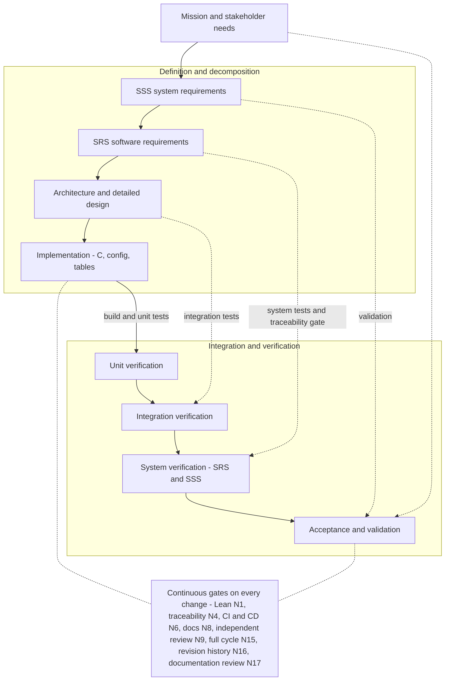

# Software Verification and Validation Plan

|                                   |                                        |
| --------------------------------: | :------------------------------------- |
| Project                          | frick-fsw                              |
| Document id                      | FRICK-VV-PLAN-001                      |
| Revision                          | 0.1.3                                  |
| Date                              | 2026-10-12                             |
| Target criticality                | ECSS B (norm N5); class-A gaps tracked |
| Applicable norms                  | N1, N3, N4, N6, N8, N9, N10, N11, N12, N14, N16, N17 |

## 1. Scope

This plan covers the software V&V of the frick-fsw framework from unit level to
system demonstration, including formal verification (norm N1) and the
qualification of V&V tools and test scripts (norm N10). It is executed in every
development and verification cycle, and the results are recorded in
`docs/vv/verification-results.md` and pushed with the cycle (norm N11).

## 2. V&V context per ECSS

- Verification against requirements: ECSS-E-ST-40C (software verification
  process) applied at levels **unit**, **integration**, **system** and
  **formal qualification**.
- Verification methods: Tst, Anl, Inp, Dem, MIR (see `ecss-criticality-b.md`).
- Product assurance: ECSS-Q-ST-80C (independence, tool qualification,
  non-conformance management).

## 3. Process on the V-model

The left branch defines and decomposes the product; the right branch integrates
and verifies it. The horizontal links are the verification relations that
ECSS-E-ST-40C requires; the norms are placed on the element that enforces them.

### V-model step mapping

| Left step (definition) | Artifact | Right step (verification) | Evidence |
| ---------------------- | -------- | ------------------------- | -------- |
| Mission and stakeholder needs | README, mission context | Acceptance and validation | independent review (N9), mission demonstration |
| SSS system requirements | `docs/requirements/SSS.md` (R3 review, N14) | System verification | SRS/SSS tests, traceability gate (N4) |
| SRS software requirements | `docs/requirements/SRS.md`, Lean (N3) | System verification | `ctest`, simulator smoke, Lean theorems (N1) |
| Architecture and detailed design | `docs/architecture/`, ADRs, ICD | Integration verification | SB/PUS integration tests, smoke |
| Implementation | `src/`, `config/`, `tests/` | Unit verification | `ctest`, Lean theorems (N1) |

### Per-change cycle (norm N15)

Every change, whatever its origin, walks the V again from requirements to the
dual CI before it is pushed (norms N7/N12/N15).

```mermaid
flowchart LR
    CH["Change - any origin"] --> REQ["Requirements delta - SSS and SRS, traceability N3 N4"]
    REQ --> IMPL["Implement - C sources, config, tables"]
    IMPL --> LEAN["Lean theorems N1"]
    LEAN --> TEST["Build, unit, integration, smoke N6"]
    TEST --> TRACE["Traceability gate N4"]
    TRACE --> DOC["Update docs N8 and revision history N16"]
    DOC --> REV["Independent review N9"]
    REV --> DREV["Documentation review R4 N17"]
    DREV --> CI["Dual CI green - GitHub and Gitea N6"]
    CI --> PUSH["Commit and push both remotes N7"]
    PUSH -.->|"next change"| CH
    PUSH -->|"non-conformance"| REQ
```

## 4. V&V environment

Deployable by humans and agents, identical everywhere (norm N6/N8):

| Environment | Description |
| ----------- | ----------- |
| Host simulator | `frick_fsw` native build (POSIX threads) with loopback link |
| RTEMS cross build | RTEMS 6.2 `riscv/mpfs64imafdc` cross compilation (`make rtems`) |
| Emulated target | Renode PolarFire SoC (`make renode`, norm N18, `renode_vv.sh`, T17) and QEMU `virt` generic BSP (`make qemu`, `qemu_vv.sh`, T20) - `docs/vv/emulated-target.md`; see tool register T15-T17/T20 |
| V&V container | `tools/docker/Dockerfile` - pinned toolchain |
| RTEMS toolchain container | `tools/docker/rtems/` - open RTEMS 6.2 toolchain + `mpfs64imafdc`/`rv64imafdc` BSPs + QEMU (`make rtems-toolchain`) |
| Gitea CI/CD | `act_runner` in Docker (`tools/docker/act_runner/`) |
| GitHub CI | `.github/workflows/ci.yml` (per-commit) + `.github/workflows/nightly.yml` (RTEMS + Renode + QEMU) |

All test scripts are versioned in the repository (norm N11) and qualified
(norm N10): see `docs/vv/tool-qualification.md`.

## 5. Verification activities and methods

### Unit level (Tst / Anl)
- `tests/unit/test_ccsds.c` - CCSDS packet build/parse, CRC, length bounds.
- `tests/unit/test_sb.c` - Software Bus publish/subscribe, FIFO, depth.
- `tests/unit/test_tbl.c` - table load/validate/activate lifecycle.
- `tests/unit/test_pus.c` - PUS dispatch, service 1 verification, S17 ping,
  memory dump region bound, unknown service handling.
- `tests/unit/test_time.c` - time-source selection, 1 Hz tone discipline
  (reject/jump/epoch), leap-second application at the tone boundary, CUC
  encode/decode framing (P-field 0x2E) and PPS backend registration (M2).
- Execution: `ctest` in the build directory.

### Formal verification (Anl, norm N1)
- Lean 4 project `verification/lean/`; `lake build` must pass.
- Theorems are linked to requirements in the traceability manifest.

### Integration / system level (Dem / Inp)
- `tools/scripts/run_sim.sh` boots the native simulator; it must report 6
  registered applications and produce EVS->PUS service 5 telemetry on the
  loopback link (simulator smoke).
- `tools/gsw/ff_gsw.py` may be used to inject telecommands and decode telemetry
  for end-to-end checks.

### Emulated target (Dem, M10)
- `make renode` runs the MPFS RTEMS image on the emulated PolarFire SoC
  (norm N18, tool T17) and checks `RENODE_TEST: PASS` plus the HAL checks.
- `make qemu` runs the generic `riscv/rv64imafdc` RTEMS image on
  `qemu-system-riscv64 -M virt` (tool T20) and checks the boot banner + the six
  registered applications. Tools qualified per N10; the real-silicon residual is
  GAP-A5. See `docs/vv/emulated-target.md`.

### Static analysis (Inp)
- `clang-format` (format), `clang-tidy` (defects/style), code inspection for
  deterministic memory (no heap after init) - evidence `ci:static-analysis`.

### Traceability (Inp / Dem, norm N4)
- `tools/scripts/trace.py` gate run by `make trace` and by CI job `trace`.

### Milestone verification (MIR)
- Pre-release review with the independent review agents (norm N9) and NC
  closure loop (norm N12).

## 6. Verification criteria

| Criteria | Criterion satisfied when |
| -------- | ------------------------ |
| Build | host Debug+Release and RTEMS cross build succeed with no errors |
| Unit | every `tests/unit/*.c` test passes in `ctest` |
| Formal | `lake build` succeeds; requirement-theorem links resolve |
| Smoke | simulator boots, 6 apps registered, TM produced |
| Static | clang-tidy clean for the configured checks; no heap-after-init |
| Traceability | `make trace` exits 0 (no gaps, no dangling ids) |
| Qualification | every V&V tool used has a QUALIFIED entry in the register |
| Reviews | independent review reports stored and NCs closed (norm N9/N12) |

## 7. Independence

Any activity that the criticality class marks as independent (norm N9) is
performed by an independent-context agent with profile R1, R2, R3 or R4
(`docs/engineering/independent-review.md`). At class B, the V&V result
assessment and tool qualification changes are reviewed independently by R2. On
every change, the documentation set is reviewed by R4 (norm N17) and the review
loop is closed before commit/push.

## 8. Result recording

Each cycle updates `docs/vv/verification-results.md` with the executed
activities, environment (docker tag / commit hash), results and any NC opened;
the update is committed and pushed with the cycle (norm N11).

## History

| Rev | Date       | Author    | Reason |
| --- | ---------- | --------- | ------ |
| 0.1 | 2026-10-10 | frick-fsw | Initial V&V plan (norm N6/N12) |
| 0.1.1 | 2026-10-10 | frick-fsw | Added the Mermaid V-model and per-change cycle diagrams (norm N8) |
| 0.1.2 | 2026-10-10 | frick-fsw | Add documentation review (R4, norm N17) to norms, gates, cycle and independence |
| 0.1.3 | 2026-10-12 | frick-fsw | M10: add the emulated-target environment/activity (Renode T17 + QEMU T20, `docs/vv/emulated-target.md`) |
