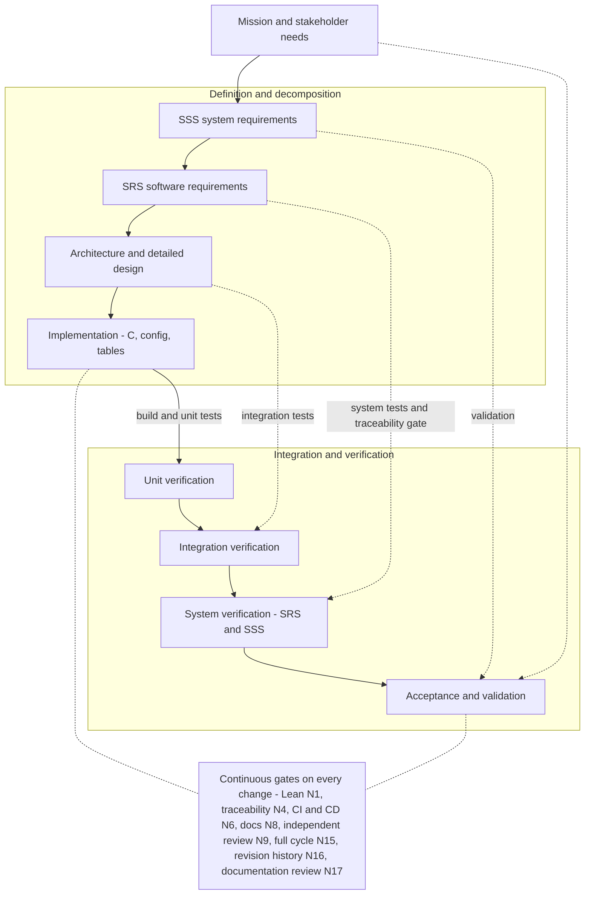

# Software Verification and Validation Plan

|                                   |                                        |
| --------------------------------: | :------------------------------------- |
| Project                          | frick-fsw                              |
| Document id                      | FRICK-VV-PLAN-001                      |
| Revision                         | 0.1.12                                  |
| Date                              | 2026-10-26                             |
| Target criticality                | ECSS B (norm N5); class-A gaps tracked |
| Applicable norms                  | N1, N3, N4, N6, N8, N9, N10, N11, N12, N14, N16, N17, N18, N20, N21, N22 |

## 1. Scope

This plan covers the software V&V of the frick-fsw framework from unit level to
system demonstration, including formal verification (norm N1) and the
qualification of V&V tools and test scripts (norm N10). It is executed in every
development and verification cycle, and the results are recorded in
`docs/vv/verification-results.md` and pushed with the cycle (norm N11).

The **controlled test specification** (norm N22) is
`docs/vv/comprehensive-test-spec.md` (FRICK-VV-TSPEC-001); the system-level
verification architecture is `docs/vv/system-verification-architecture.md`
(FRICK-VV-SVA-001).

The bounded OBCP adapter/engine connectivity test is specified separately in
`docs/vv/test-spec/ts-9-obcp-integration.md` (FRICK-VV-TS-9). It is explicitly
limited to host callback connectivity and is not evidence of SRS-REQ-045 closure.

## 2. V&V context per ECSS

- Verification against requirements: ECSS-E-ST-40C (software verification
  process) applied at levels **unit**, **integration**, **system** and
  **formal qualification**.
- Verification methods: Tst, Anl, Inp, Dem, MIR (see `ecss-criticality-b.md`).
- Product assurance: ECSS-Q-ST-80C (independence, tool qualification,
  non-conformance management).

## 3. Process on the V-model

The left branch defines and decomposes the product; the right branch integrates
and verifies it. The horizontal links are the verification relations that
ECSS-E-ST-40C requires; the norms are placed on the element that enforces them.

### V-model step mapping

| Left step (definition) | Artifact | Right step (verification) | Evidence |
| ---------------------- | -------- | ------------------------- | -------- |
| Mission and stakeholder needs | README, mission context | Acceptance and validation | independent review (N9), mission demonstration |
| SSS system requirements | `docs/requirements/SSS.md` (R3 review, N14) | System verification | SRS/SSS tests, traceability gate (N4) |
| SRS software requirements | `docs/requirements/SRS.md`, Lean (N3) | System verification | `ctest`, simulator smoke, Lean theorems (N1) |
| Architecture and detailed design | `docs/architecture/`, ADRs, ICD | Integration verification | SB/PUS integration tests, smoke |
| Implementation | `src/`, `config/`, `tests/` | Unit verification | `ctest`, Lean theorems (N1) |

### Per-change cycle (norm N15)

Every change, whatever its origin, walks the V again from requirements to the
dual CI before it is pushed (norms N7/N12/N15).

```mermaid
flowchart LR
    CH["Change - any origin"] --> REQ["Requirements delta - SSS and SRS, traceability N3 N4"]
    REQ --> IMPL["Implement - C sources, config, tables"]
    IMPL --> LEAN["Lean theorems N1"]
    LEAN --> TEST["Build, unit, integration, smoke N6"]
    TEST --> TRACE["Traceability gate N4"]
    TRACE --> DOC["Update docs N8 and revision history N16"]
    DOC --> REV["Independent review N9"]
    REV --> DREV["Documentation review R4 N17"]
    DREV --> CI["Dual CI green - GitHub and Gitea N6"]
    CI --> PUSH["Commit and push both remotes N7"]
    PUSH -.->|"next change"| CH
    PUSH -->|"non-conformance"| REQ
```

## 4. V&V environment

Deployable by humans and agents, identical everywhere (norm N6/N8):

| Environment | Description |
| ----------- | ----------- |
| Host simulator | `frick_fsw` native build (POSIX threads) with loopback link |
| RTEMS cross build | RTEMS 6.2 `riscv/mpfs64imafdc` cross compilation (`make rtems`) |
| Emulated target | Renode PolarFire SoC (`make renode`, norm N18, `renode_vv.sh`, T17) and QEMU `virt` generic BSP (`make qemu`, `qemu_vv.sh`, T20) - `docs/vv/emulated-target.md`; see tool register T15-T17/T20 |
| V&V container | `tools/docker/Dockerfile` - controlled tool image; base/package sources are not fully immutable (NC-EXT-35) |
| RTEMS toolchain container | `tools/docker/rtems/` - open RTEMS 6.2 toolchain + `mpfs64imafdc`/`rv64imafdc` BSPs + QEMU (`make rtems-toolchain`) |
| Gitea CI/CD | `act_runner` in Docker (`tools/docker/act_runner/`) |
| GitHub CI | `.github/workflows/ci.yml` (per-commit) + `.github/workflows/nightly.yml` (RTEMS + Renode + QEMU) |

All test scripts are versioned in the repository (norm N11). Qualification
status and owner-deferred exceptions are recorded in
`docs/vv/tool-qualification.md` (norm N10).

## 5. Verification activities and methods

### Unit level (Tst / Anl)
- `tests/unit/test_ccsds.c` - CCSDS packet build/parse, CRC, length bounds.
- `tests/unit/test_sb.c` - Software Bus publish/subscribe, FIFO, depth.
- `tests/unit/test_tbl.c` - table load/validate/activate lifecycle.
- `tests/unit/test_pus.c` - PUS dispatch, service 1 verification, S17 ping,
  memory dump region bound, unknown service handling.
- `tests/unit/test_time.c` - time-source selection, 1 Hz tone discipline
  (reject/jump/epoch), leap-second application at the tone boundary, CUC
  encode/decode framing (P-field 0x2E) and PPS backend registration (M2).
- Execution: `ctest` in the build directory.

### Formal verification (Anl, norm N1)
- Lean 4 project `verification/lean/`; `lake build` must pass.
- Theorems are linked to requirements in the traceability manifest.

### Integration / system level (Dem / Inp)
- `tools/scripts/run_sim.sh` boots the native simulator; it must report 7
  registered applications and produce EVS->PUS service 5 telemetry on the
  loopback link (simulator smoke).
- `tools/gsw/ff_gsw.py` may be used to inject telecommands and decode telemetry
  for end-to-end checks.

### Emulated target (Dem, M10)
- `make renode` runs the MPFS RTEMS image on the emulated PolarFire SoC
  (norm N18, tool T17) and checks `RENODE_TEST: PASS` plus the HAL checks.
- `make qemu` runs the generic `riscv/rv64imafdc` RTEMS image on
  `qemu-system-riscv64 -M virt` (tool T20) and checks the boot banner + the seven
  registered applications. Tool qualification status is controlled by the N10
  register; this plan does not infer qualification from execution evidence. The
  real-silicon residual is GAP-A5. See `docs/vv/emulated-target.md`.

### Static analysis (Inp)
- `clang-format` (format), `clang-tidy` (defects/style), code inspection for
  deterministic memory (no heap after init) - evidence `ci:static-analysis`.

### Traceability (Inp / Dem, norm N4)
- `tools/scripts/trace.py` gate run by `make trace` and by CI job `trace`.

### Milestone verification (MIR)
- Pre-release review with the independent review agents (norm N9) and NC
  closure loop (norm N12).

## 5.1 Execution layers and environments (current)

| Layer | Environment / target | What it executes | Evidence semantics |
| ----- | -------------------- | ---------------- | ------------------ |
| Host unit / integration | native POSIX build (`build/<...>`, CTest) | production C objects, unit/integration test binaries, fail-closed tool fixtures | host SIL only; no target scheduling, WCET, hardware or HIL |
| Host model validation | native POSIX, test-only stubs | XW-1 external-watchdog abstract model and middleware contract (`--wrap` of three hooks) | model-vs-contract and middleware evidence, not a device |
| Host functional | native simulator (`run_sim.sh`) | 7-app boot, EVS→PUS S5 on loopback | smoke, not mission or timing evidence |
| QEMU generic RTEMS, TEST-ONLY | `qemu-system-riscv64 -M virt`, cached RTEMS toolchain image | T1 requirement suite (PIL harness), XW-2 test-only watchdog image, XW-3 external TC/TM image | test-only emulated target; not Renode/N18, not PolarFire peripherals, not a device |
| Renode PolarFire SoC | `make renode`, pinned Renode image + MPFS RTEMS image | production-shaped `RENODE_TEST` functional image | norm N18; **current candidate FAIL**, marker absent; not HIL |
| RTEMS cross-build | `frick-rtems-toolchain:local`, `rtems-riscv-mpfs.cmake` | compile/link of the flight-shaped image | build evidence only |
| Static / formal / docs | host + pinned V&V image | format, JSON, Doxygen, Lean, traceability, coverage/metrics | tool and document gates; advisory where stated |
| HIL / physical target | — | not performed | **NOT RUN / not claimed** |

## 5.2 Actual tests summary (verified read-only, current tree)

The table is an inventory of executed/retained families, not a claim that every
row passed on the current candidate. Requirements are traced per test in
`docs/requirements/traceability.yaml` (the `tests:` rows); evidence pointers are
to `docs/vv/verification-results.md` and retained run/log directories.

**Evidence descriptors (resolving in-repo links unless marked external).** These are the
authoritative pointers used in the rows below; they are not a second results table.

| ID | Evidence (resolving path) | Applies to / scope |
| --- | --- | --- |
| S1-host | [gates/S1-host.log](evidence/2026-10-26-xw3-finishing/gates/S1-host.log) | host configure/build/CTest 54/54, 2026-10-26 |
| S1-Lean | [gates/S1-lean-trace.log](evidence/2026-10-26-xw3-finishing/gates/S1-lean-trace.log) | Lean + receipt + trace, 2026-10-26 |
| S2 | [gates/S2-smoke.log](evidence/2026-10-26-xw3-finishing/gates/S2-smoke.log) | host smoke, 7 apps |
| S3 | [gates/S3-gsw.log](evidence/2026-10-26-xw3-finishing/gates/S3-gsw.log) | GSW/license/metrics self-check |
| S4 | [gates/S4-coverage-metrics.log](evidence/2026-10-26-xw3-finishing/gates/S4-coverage-metrics.log) | coverage + metrics check |
| S5-historic | [gates/S5-docs.log](evidence/2026-10-26-xw3-finishing/gates/S5-docs.log) | gate-window Doxygen, **141** warnings (historic) |
| S6 | [gates/S6-format-json.log](evidence/2026-10-26-xw3-finishing/gates/S6-format-json.log) | format/diff/JSON/status |
| S7 | [gates/S7-rtems-cross.log](evidence/2026-10-26-xw3-finishing/gates/S7-rtems-cross.log) | RTEMS cross-build |
| S9/S10 | [gates/S9-S10-focused.log](evidence/2026-10-26-xw3-finishing/gates/S9-S10-focused.log) | link_uart + focused regressions |
| XW3-run | [run/XW3-A1...](evidence/2026-10-26-xw3-finishing/run/xw3-run-20261026T122213Z/run-result.json) | XW-3 run result (PASS) |
| XW3-controls | [fixtures controls](evidence/2026-10-26-xw3-finishing/run/xw3-fixtures-20261026T122213Z/controls.json) | 15/15 controls |
| XW3-incomplete | [skip-cases result](evidence/2026-10-26-xw3-finishing/run/xw3-run-20261026T122450Z/run-result.json) | expected FAIL control |
| VR-3.33 | [verification-results](verification-results.md) | current gate-window record |
| Final-doc bundle | external historic: `/home/nicola/.openclaw/workspace/jeeves/reports/fsw-target-io-2026-10-25/MSG2040-EVIDENCE-FINAL3-20261026T133000Z/` (`3919f193…`, pre-pointer checks); pointer-corrected checks: `MSG2040-POINTERS-EVIDENCE-20261026T133500Z/` (`9321aa47…`; final bundle hash in `MSG2040-POINTERS-HANDOVER.md`) | Doxygen 147, trace, metrics, diff, JSON, link 41/528/0; **external, not a repo link** |
| N18-FAIL | [process log](evidence/2026-10-21-s8-fdir-n18-current-process.log) / [console](evidence/2026-10-21-s8-fdir-n18-current-uart-console.log) | prior N18 FAIL identity |

| Family / test(s) | Type | Environment / actual script or target | Purpose | Requirements / evidence | Status / limits |
| --- | --- | --- | --- | --- | --- |
| `ccsds`, `r2_gap`, `decoder_corpus`, `link_uart` | requirement-based unit / mutation corpus / focused UART | host CTest, `tests/unit/test_ccsds.c`, `test_r2_gap.c`, `test_decoder_corpus.c`, `test_link_uart.c` | CCSDS build/parse, CRC, PDL/bounds, malformed corpus | traceability rows for SRS-REQ-003/004/017; [S1-host](evidence/2026-10-26-xw3-finishing/gates/S1-host.log), [VR-3.33](verification-results.md) | PASS on host; not target codec/timing |
| `sb`, `sb_stress`, `sb_sweep_boundary`, `sb_evs_structural_sweep` | unit + structural characterization | host CTest, `test_sb*.c`, `sb_evs_structural_sweep.py` | SB publish/subscribe, depth, backpressure, structural sweep | SRS-REQ-001/011/072 rows; [S1-host](evidence/2026-10-26-xw3-finishing/gates/S1-host.log) + retained sweep CSV | PASS/characterization; not mission profile/WCET |
| `pus`, `pus_fu`, `r3_gap`, `pus_n7_adapter_contract`, `pusopen_adapter_contract`, `obcp_engine_connectivity` | unit / integration / boundary | host CTest, `test_pus*.c`, `test_r3_gap.c`, adapter/connectivity tests | PUS dispatch, S1/S5/S17, service bounds, adapters, OBCP connectivity | traceability PUS/SRS rows; [S1-host](evidence/2026-10-26-xw3-finishing/gates/S1-host.log), [S10](evidence/2026-10-26-xw3-finishing/gates/S9-S10-focused.log) | PASS where configured; OBCP connectivity is not SRS-REQ-045 closure |
| `tbl`, `sched`, `time`, `pal_watchdog`, `wd_host_model_contract`, `es_hs_lifecycle` | unit / requirement-based | host CTest, `test_tbl.c`, `test_sched.c`, `test_time.c`, `test_pal_watchdog.c`, `test_wd_host_contract.c`, `test_es_hs_lifecycle.c` | table lifecycle, scheduler, time/CUC, SUT watchdog, internal register model, ES/HS lifecycle | SRS-REQ-024/073/075/…; [S1-host](evidence/2026-10-26-xw3-finishing/gates/S1-host.log) | PASS on host; no target timing/HIL |
| `extwd_model`, `extwd_middleware` | model validation / middleware contract | host CTest, `tests/stubs/ff_test_extwd_model.c`, `tests/unit/test_extwd_model.c`, `test_extwd_middleware.c` | external-watchdog abstract C1–C7, arm/feed/expiry/reset counters, fail-closed statuses | SRS-REQ-073/075, XW-1 contract; [VR-3.29](verification-results.md) | PASS on host/model; **not a device/backend/HIL** |
| `target_req_verify_fixtures`, `target_run_verdict_fixtures`, `qemu_runner_failclosed_fixtures`, `uart_tm_verify_fixtures`, `qemu_uart_runner_failclosed_fixtures`, `renode_vv_verdict_failclosed_fixtures`, `renode_vv_verdict` | negative controls / fail-closed tools | host CTest, Python/shell fixture drivers and Renode verdict regression | prove missing/stale/fatal/nonzero/empty evidence fails closed | N10 tool qualification rows; [S1-host](evidence/2026-10-26-xw3-finishing/gates/S1-host.log) fixture CTest entries | PASS (fixtures); not live-target evidence |
| `hal`, `math`, `sdls`, `gem`, `gem_tsn`, `gptp`, `netloop`, `gpio`, `serial`, `mem`, `nvm`, `mtd`, `can`, `i2c`, `spi`, `block`, `pcie`, `spacewire`, `fabric`, `canfd`, `canopen`, `link_ip`, `link_tsn`, `lwip`, `lwip_netif` | unit / contract / host integration | host CTest, `tests/unit/test_*.c` | HAL contracts, drivers, net/lwIP, SDLS, math, fabric contracts | traceability rows; [S1-host](evidence/2026-10-26-xw3-finishing/gates/S1-host.log) 54/54 | PASS/contract; unmodelled peripherals remain BLOCKED (GAP-A5) |
| Lean formal proof | formal (Anl) | `verification/lean/lake build`, `lean_elab_receipt.py` | SRS-linked theorems, receipt identity | N1/N3, traceability Lean rows; [S1-Lean](evidence/2026-10-26-xw3-finishing/gates/S1-lean-trace.log) | PASS on current tree; not a code refinement proof |
| Traceability | static analysis | `tools/scripts/trace.py docs/requirements/traceability.yaml` | SRS/SSS/GAP/Lean convergence | N4; [S1-Lean](evidence/2026-10-26-xw3-finishing/gates/S1-lean-trace.log) (120/76/30/14, 68 theorems) | PASS; not requirement completeness |
| Host smoke | functional smoke | `tools/scripts/run_sim.sh` | 7 apps, EVS→PUS S5 on loopback | N6; [VR-3.33](verification-results.md) | PASS; not target/WCET |
| GSW / license / metrics | functional Python + policy | `make gsw-selfcheck` (`test_ff_gsw.py`, `test_metrics.py`, `test_license_check.py`, `ff_gsw.py --ping`) | ground-tool encode/decode, metrics, MPL-2.0/SPDX | N8/N13; [S3](evidence/2026-10-26-xw3-finishing/gates/S3-gsw.log) | PASS host self-check; `--ping` without device is frame/CRC self-check only |
| Coverage/metrics | coverage (Inp) | `coverage.py`, `metrics.py --check` | gcov line/function coverage, README panel | GAP-A4, [NC-EXT-225](../planning/sprint-plan.md), [S4](evidence/2026-10-26-xw3-finishing/gates/S4-coverage-metrics.log) | PASS measurement; branch/MC-DC/WCET not measured; panel path binding residual |
| Format/JSON/static | static | `clang-format --dry-run --Werror`, `git diff --check`, `json.tool` | managed C/H format, whitespace, status/manifest JSON | N8/N10; [S6](evidence/2026-10-26-xw3-finishing/gates/S6-format-json.log) | PASS; advisory static only |
| Docs build | documentation | `doxygen` in cached `frick-vv:local`, isolated output | API/doc generation; unresolved references visible | N8/N17; [S5-historic](evidence/2026-10-26-xw3-finishing/gates/S5-docs.log) + external Final-doc bundle (see descriptors) | PASS exit 0; 147 warning lines final (141 historical), not warning-free |
| T1 QEMU PIL suite | requirement-based target (test-only) | `tools/scripts/qemu_req_vv.sh`, generic RTEMS/QEMU `build/t1-qemu` | L1–L8 and L10 requirement cases in PIL harness; L9 is a declared GAP (NC-EXT-17) | SRS/T1 rows; [VR-3.16–3.18](verification-results.md) | Component PASS; whole-run FAIL at watchdog init; not N18 |
| T2 external UART | integration (test-only, BLOCKED) | `tools/scripts/qemu_uart_tc_vv.sh`, `uart_tm_verify.py` | real serial TC/TM path on generic image | T29; [VR-3.19–3.25](verification-results.md) | RUN FAIL/BLOCKED; `-nographic` mux defect NC-EXT-223; not a target PASS |
| XW-2 abstract contract image | emulated-target test-only | `tools/scripts/qemu_xw2_vv.sh`, `xw2_manifest.json`, `tests/target/*_xw2*` | 13 contract cases + no-wrap control on QEMU RTEMS | SRS-REQ-073/075; [VR-3.31](verification-results.md) + XW2 manifest | 13/13 component PASS, whole-run PASS; test-only, not N18/device |
| XW-3 external TC/TM | integration / negative controls (test-only) | `tools/scripts/qemu_xw3_vv.sh`, `xw3_verdict.py`, `xw3_negative_controls.py` | serial stdin → unchanged link/CMD_INGEST/PUS → captured TM; 15 controls | SRS-REQ-004/005/006/007/012/017; [XW3-run](evidence/2026-10-26-xw3-finishing/run/xw3-run-20261026T122213Z/run-result.json), [XW3-controls](evidence/2026-10-26-xw3-finishing/run/xw3-fixtures-20261026T122213Z/controls.json) | PASS, 15/15; test-only, not N18/device |
| Renode N18 | functional target validation | `tools/scripts/renode_vv.sh`, `renode_vv_verdict.sh`, MPFS RTEMS image | production-shaped `RENODE_TEST: PASS` | SRS-REQ-044; [N18-FAIL process](evidence/2026-10-21-s8-fdir-n18-current-process.log) / [console](evidence/2026-10-21-s8-fdir-n18-current-uart-console.log) | **FAIL / NOT RERUN** (watchdog init, NC-PAL-01/NC-EXT-198); not HIL |
| Tool qualification / reviews | process | `docs/vv/tool-qualification.md`, `docs/engineering/independent-review.md`, review reports | N10 qualification, R1/R2/R3/R4/PA independence | N9/N10/N17/N20; [tool qualification](tool-qualification.md), [independent review](../engineering/independent-review.md) | T33–T36 NOT QUALIFIED — human qualification owner-deferred (NC-EXT-232); T25–T32 not current acceptance evidence/review pending; N17/N20 AI delta records only |
| HIL / physical target | future | — | reset/pin/electrical/real-device timing | — | **NOT PERFORMED / not claimed** |

## 5.3 Evidence semantics

A green row means the stated oracle passed in that environment, not a broader
claim. Host PASS does not imply target timing; QEMU generic RTEMS is a test-only
emulated target; Renode is the N18 environment and currently **FAIL**; a model
validated against its contract is not a device; HIL is not performed. The
external-watchdog test-only QEMU/abstract model is **not** the flight backend,
device or HIL, and no mission timeout/cadence is asserted (the 8 s table value
remains an ESC-7 placeholder).

## 6. Verification criteria

| Criteria | Criterion satisfied when |
| -------- | ------------------------ |
| Build | host Debug+Release and RTEMS cross build succeed with no errors |
| Unit | every `tests/unit/*.c` test passes in `ctest` |
| Formal | `lake build` succeeds; requirement-theorem links resolve |
| Smoke | simulator boots, 7 apps registered, TM produced |
| Static | clang-tidy clean for the configured checks; no heap-after-init |
| Traceability | `make trace` exits 0 (no gaps, no dangling ids) |
| Qualification | every V&V tool used has a QUALIFIED entry in the register |
| Reviews | independent review reports stored and NCs closed (norm N9/N12) |

## 7. Independence

Any activity that the criticality class marks as independent (norm N9) is
performed by an independent-context agent with profile R1, R2, R3 or R4
(`docs/engineering/independent-review.md`). At class B, the V&V result
assessment and tool qualification changes are reviewed independently by R2. On
every change, the documentation set is reviewed by R4 (norm N17) and the review
loop is closed before commit/push.

### 7.1 Review summary and authoritative crosslink

`docs/engineering/independent-review.md` is the authoritative profile/trigger
document; this table is the execution summary and must stay synchronized with it.

| Profile | Trigger / scope | Artifact location | Current state / gate |
| --- | --- | --- | --- |
| R1 FSW | design/code/architecture change; pre-release | `docs/reviews/` or authorized external report path | per-change as applicable; not a blanket approval |
| R2 V&V | test/tool qualification (N10), V&V results, pre-release | `docs/reviews/`, `docs/vv/tool-qualification.md` | T33–T36 NOT QUALIFIED — human qualification owner-deferred (NC-EXT-232); T25–T32 not current acceptance evidence |
| R3 systems | SSS creation/change (N14), requirement/system ambiguity | `docs/reviews/` | SSS mission baseline authority items remain OPEN |
| R4 documentation | every change (N17), docs set correctness/completeness | `docs/reviews/`; XW-3 finishing reports are in the authorized external path disclosed in tool-qualification | AI delta records exist; **human N17 gate not inferred** |
| PA | every phase product (N20), findings fixed/re-reviewed | `docs/reviews/`; external XW-3 finishing path disclosed | AI PASS WITH CONDITIONS records; **human PA/CM conditions remain OPEN** |

The review NC loop is N12: findings are registered, corrected, and re-reviewed;
no AI report substitutes for human qualification/PA/CM authority. Evidence is
retained immediately (N11); commit/push waits for all applicable gates (N7).

## 8. Result recording

Each cycle updates `docs/vv/verification-results.md` with the executed
activities, environment (docker tag / commit hash), results and any NC opened;
the update is committed and pushed with the cycle (norm N11).

## 9. Sprint verification set (executed and retained at every sprint)

Owner direction (2026-10-16): in addition to the per-change cycle above, the
following named set is executed and its raw output retained **at every sprint**,
so sprint-level evidence identity is explicit and reproducible. Raw logs are
stored under `docs/vv/evidence/` and their SHA-256 hashes recorded in
`docs/vv/verification-results.md` (norm N11). A member that cannot run on a
given host is recorded as SKIP with the reason and is never counted as a pass.

| # | Check | Command | Scope / limitation |
| - | ----- | ------- | ------------------ |
| S1 | Host build + unit tests + Lean + trace | `make ci-local` | 54/54 CTest (current tree; 53/53 with `FF_USE_N7_OBCP=OFF`) (incl. `test_es_hs_lifecycle`, `test_pal_watchdog`, `test_decoder_corpus`), Lean `lake build`, `trace.py`; no format/smoke/docs |
| S2 | Simulator smoke | `make smoke` | 7 apps registered, EVS→PUS TM on loopback |
| S3 | GSW / metrics / license self-check | `make gsw-selfcheck` | GSW python tests, README metrics, N13 license policy |
| S4 | Coverage metrics | `make metrics` | regenerates README panel; the S8-VV-FU coverage CTest subset passes (54/54) |
| S5 | Documentation generation | `make docs` | Doxygen; warning count is recorded, not claimed "warning-free" |
| S6 | Format + whitespace + JSON | `clang-format --dry-run --Werror`, `git diff --check`, `python3 -m json.tool` | all managed C/H, no trailing whitespace, valid status JSON |
| S7 | RTEMS cross-build | `make rtems-docker` | compile/link evidence only; not target runtime/timing |
| S8 | Emulated-target functional validation | `make renode` | Renode emulation (norm N18); not physical hardware |
| S9 | Focused UART PDL host test | `test_link_uart` | host PTY framing cases (NC-EXT-07 characterization); not physical UART |
| S10 | Focused R2-gap regression + S8-VV-FU corpus | `test_r2_gap`, `test_es_hs_lifecycle`, `test_decoder_corpus` | CCSDS/ingest/GSW corrections plus the bounded ES/HS lifecycle and decoder fuzz/property corpus with requirement-grounded oracles (GAP-R3-1, NC-EXT-25) |

Physical-target tests are excluded from the every-sprint set per the owner
decision of 2026-10-16 (postponed); their absence is disclosed on the README
homepage and does not close target-dependent NCs. Adding or removing a member
of this set is itself a change and follows the same N15/N17/N20 gates.

> **Per-sprint membership by evidence class.** For a delta that changes **no
> source/configuration/script content** (e.g. the 2026-10-19 easy-fixes
> documentation/test-spec delta), S7 (RTEMS cross-build) and S8 (Renode
> emulated-target functional validation) are recorded as **not applicable to
> that delta** rather than as passes: S7's `make rtems-docker` compile/link
> evidence is regenerated on demand and was satisfied for the `318f49b` commit
> by hosted CI run `39218060325` (job "RTEMS 6.2 cross build (riscv/mpfs64imafdc)" = success);
> S8/N18 Renode functional validation is not re-run because the change cannot
> regress target behaviour, and its absence is disclosed rather than counted.
> This per-delta rationale is recorded here so the N18 gate is visibly honored,
> not elided; it does not close the target-dependent NCs tracked in NC-EXT-31
> and the GAP-A5 row.

## 10. Durable maintenance and normal loop checklist

This is a **manual maintenance rule**, not a scheduler/automation change.

| Artifact | Technical owner | Structure/consistency owner | Update trigger |
| --- | --- | --- | --- |
| `docs/vv/verification-plan.md` (this test/environment matrix and evidence semantics) | SW V&V engineer | SW documentation engineer | any new/changed test, family, environment, oracle, status or evidence path |
| `docs/engineering/independent-review.md` (profiles, triggers, review summary) | SW V&V engineer | SW documentation engineer | profile/trigger/gate change or new review artifact class |
| `docs/vv/verification-results.md`, `docs/vv/evidence/` | SW V&V engineer | SW documentation engineer | each executed cycle (N11/N16) |
| `docs/vv/tool-qualification.md` | SW V&V engineer | SW documentation engineer | tool/script or qualification-state change (N10) |

**Normal loop checklist (add to the per-change cycle):** when tests,
environments, oracles, review profiles or gates change, (1) update the actual
tests table and environment semantics here; (2) update the independent-review
summary/crosslink; (3) update `verification-results` and retained evidence;
(4) update tool qualification; (5) update the revision history. No owner may
invent a PASS, a qualification or an N18 closure in these rows.

## History

| Rev | Date       | Author    | Reason |
| --- | ---------- | --------- | ------ |
| 0.1 | 2026-10-10 | frick-fsw | Initial V&V plan (norm N6/N12) |
| 0.1.1 | 2026-10-10 | frick-fsw | Added the Mermaid V-model and per-change cycle diagrams (norm N8) |
| 0.1.2 | 2026-10-10 | frick-fsw | Add documentation review (R4, norm N17) to norms, gates, cycle and independence |
| 0.1.3 | 2026-10-12 | frick-fsw | M10: add the emulated-target environment/activity (Renode T17 + QEMU T20, `docs/vv/emulated-target.md`) |
| 0.1.4 | 2026-10-14 | frick-fsw | Reference the N22 controlled test specification (`FRICK-VV-TSPEC-001`) and the system verification architecture (`FRICK-VV-SVA-001`) |
| 0.1.5 | 2026-10-16 | frick-fsw | Add §9 "Sprint verification set" (owner direction): the named S1-S10 checks executed and retained at every sprint, with the physical-target exclusion disclosed |
| 0.1.6 | 2026-10-16 | frick-fsw | S8-VV-FU: extend §9 S1 to 40/40 CTest (add `test_es_hs_lifecycle`, `test_decoder_corpus`) and S10 to include the new bounded ES/HS lifecycle and decoder fuzz/property corpus; update S4 wording to the S8-VV-FU coverage subset |
| 0.1.7 | 2026-10-18 | frick-fsw | Correct the stale §9 S1/S4 CTest count to the current 43/43 (the 40/40 figure predates the S8-PUS-FU/S8-SCH tests added to the suite); synchronize the document header revision |
| 0.1.8 | 2026-10-19 | frick-fsw | Add a per-delta accountability note for §9 S7/S8 (F-0383-03): for a no-source/test-spec-only delta such as the 2026-10-19 easy-fixes batch, S7 is satisfied-by-hosted-CI (run 39218060325, RTEMS cross-build success) and S8/N18 Renode is a recorded non-application, not a pass; this honors the N18 gate rather than eliding it and closes no target NC (NC-EXT-31, GAP-A5) |
| 0.1.9 | 2026-10-20 | frick-fsw | Correct the default registered-application count to seven in smoke and QEMU environments after S8-FDIR-01; no change to target-coverage claims |
| 0.1.10 | 2026-10-26 | frick-fsw | XW-3 finishing: correct the §9 S1/S4 executed CTest count from 44/44 to the live **54/54** (53/53 with `FF_USE_N7_OBCP=OFF`); the S1/S4 substance, S1–S10 membership and all limits are unchanged |
| 0.1.11 | 2026-10-26 | frick-fsw | MSG2040 canonical V&V detail: add execution-layer/environment semantics, the actual test-family summary table (scripts/targets/requirements/evidence/status/limits), evidence-semantics limits, the authoritative independent-review summary/crosslink, and the durable ownership/maintenance checklist; correct the smoke app count to 7. No test, environment, requirement, gate or qualification state changed |
| 0.1.12 | 2026-10-26 | frick-fsw | Record the msg2046 owner disposition in the §5.2/§7.1 review rows: T33–T36 technical verification retained but **NOT QUALIFIED** and human qualification owner-deferred under NC-EXT-232; T25–T32 are not current acceptance evidence. No test/environment/gate change and no qualification inference |
| 0.1.13 | 2026-10-26 | frick-fsw | Correct stale qualification wording in §4/§5 and include the applicable N18/N20 norms; qualification and N18 status remain unchanged |
